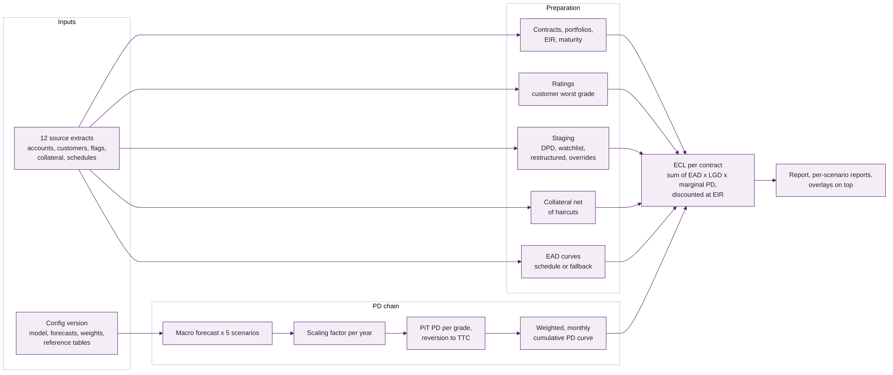

# 1. Purpose and scope

This document describes how the IFRS 9 ECL tool calculates the expected credit
loss (ECL) for QDB's lending and investment books: what goes in, every step of
the calculation with its formula, and what comes out. It describes the tool as
built (engine `ifrs9qdb` 0.51.0). Every formula here was checked against the
engine's code and against contracts recomputed by hand from the formulas alone.

**Books covered**

| Book | Portfolios | Rating scale | PD model |
|---|---|---|---|
| Lending | Business Finance, Off BS (guarantees, letters of credit), Al Dhameen, Tasdeer | Internal (QDB 1+ to QDB 9, 21 notches) | Non-oil GDP model (internal) |
| Investments | Investments (sukuk, bonds), Banks and Fis (placements) | External (Aaa to C, 21 notches) | GCC GDP model (external) |

**One calculation everywhere.** The run's report, the movement analysis,
every parameter stress, scenario stress and what-if price contracts with the
same function. A number on one page cannot disagree with the same number on
another.

**What the tool does not do.** It does not change source data; problems are
reported, not fixed silently. It does not convert currencies: balances are
used as delivered in the extract (the FX table is passed on with the LIC files
only). Stage 3 is provisioned at the full outstanding balance (section 10.3).

# 2. The calculation in one page

For every Stage 1 and Stage 2 contract:

$$
\text{ECL} \;=\; \min\!\Big(\text{Balance},\;\sum_{t=0}^{H-1} \text{EAD}_t \times \text{LGD} \times \big(\text{cumPD}_{t+1}-\text{cumPD}_{t}\big)\times \frac{1}{(1+\text{EIR})^{t/12}}\Big)
$$

| Symbol | Meaning | Section |
|---|---|---|
| $t$ | month from the reporting date, 0, 1, 2, … | |
| $H$ | horizon in months: 12 for Stage 1 (or less if the contract ends sooner), the remaining life for Stage 2 | 8.4 |
| $\text{EAD}_t$ | exposure at default in month $t$: the repayment schedule, or a fallback shape | 8 |
| LGD | loss given default, one number per contract, from collateral | 9 |
| $\text{cumPD}_t$ | cumulative PD up to month $t$ for the contract's portfolio and grade ($\text{cumPD}_0=0$) | 7 |
| EIR | effective interest rate, as a decimal | 4.3 |
| Balance | the on-balance amount (ONBALANCE); the ECL is never above it | 10.2 |

Stage 3 contracts are provisioned at 100% of the balance.

The order of work in a run:

1. Read and check the 12 extracts (section 3, section 13).
2. Prepare contracts: identifiers, portfolios, EIR, maturity (section 4).
3. Rate each customer (section 5) and stage each contract (section 6).
4. Pause for overrides (rating, stage, restructuring), each with a reason.
5. Build the PD curves from the macro forecast and the scenario weights (section 7).
6. Build the EAD curves and the collateral, then price every contract (sections 8 to 10).
7. Write the report, one report per scenario, and the run's records; overlays
   are applied on top afterwards (section 11).

# 3. Inputs

## 3.1 The 12 source extracts

The Oracle jobs deliver 12 files (Excel, or SQL*Plus HTML saved as `.xls`;
the format is detected from the file's first bytes, not its extension).
Columns are found by name and, where the export truncates names, by position.

| Extract | One row per | Main fields used |
|---|---|---|
| AccountMaster | lending contract | contract id, customer id, product (ACCOUNTTYPE), open and maturity date, days past due, ONBALANCE, OFFBALANCE, CCF, EIR, payment frequency, deferral, nominal rate, payment type, restructured flag |
| AccountMasterInvestments | investment holding | holding id, counterparty, account type, rating, ONBALANCE, maturity, EIR |
| CustomerMaster | lending customer | customer id, name, rating, days past due |
| CustomerMasterInvestments | counterparty | name, rating |
| CustomerStagingFlag | lending customer | watchlist flag, local flag 1 (restructured) |
| CustomerStagingFlagInvestments | counterparty | flags (mostly blank) |
| Collateral | collateral item | collateral id, type, currency, value |
| AccountCollateralAllocation | allocation | collateral id, contract id, allocation % |
| RepaymentSchedule | instalment | contract id, due date, principal, profit, repayment, balance after the payment |
| Origination | lending contract | origination rating (and PD where supplied) |
| OriginationInvestments | holding | origination rating |
| IndustryCode | customer | ISIC code and description |

## 3.2 Reference tables and configuration

Everything a run is told, other than the extracts, sits in a **config
version**: a frozen, named copy of the configuration and the reference tables
(section 14). The main parts:

| File | Holds |
|---|---|
| `model_inputs.yml` | the quarter's macro forecasts (5 years), scenario weight settings, the GCC growth and GDP forecasts by country |
| `model.yml` | the PD models (coefficients, standard deviations, weights), the TTC anchor PD, horizons, ECL settings (Stage 3 method, exposure cap, EAD fallback shapes) |
| `ttc_pd_table.csv` | one through-the-cycle PD per grade, both scales |
| `master_rating_scale.csv` | the internal and external grades and their position (1 to 21) |
| `scenario_severity.csv` | the five scenarios and their severity $z$ |
| `product_portfolio_mapping.csv` | product type → portfolio |
| `collateral_types.csv` | collateral type → haircut |
| `staging_thresholds.csv` | the Stage 2 days-past-due threshold, the maturity extension |
| `collective_assessment_rules.csv` | grades by days past due for Agriculture, Fisheries and Livestock |
| `segment_fallback_ratings.csv` | grades for unrated customers |
| `industry_sector_mapping.csv` | ISIC code → sector |
| `non_oil_gdp_history.csv`, `gcc_real_gdp_growth.csv`, `gcc_gdp_current_prices.csv` | the histories the scenario weights and the external model read |
| `fx_rates.csv` | FX rates, passed to the LIC files |

# 4. Preparing the contracts

## 4.1 Contract identifiers

A numeric contract id loses its leading zeros. An id with a product code in
positions 8 to 10 (for example `0000121FGG007659`) has the code replaced by
its number from `off_balance_products.csv` and is then read as a number
(`0000121` + `3` + `007659` → `1213007659`), as the Excel ETL did.

## 4.2 Portfolio

The portfolio is looked up from the product type (ACCOUNTTYPE) in
`product_portfolio_mapping.csv`; an unmapped product falls to Business
Finance, so it is still provisioned. Investments are **Banks and Fis** when
the account type says so and **Investments** otherwise.

## 4.3 Effective interest rate

The extract carries the EIR in percent (4.2 means 4.2% a year); the tool
divides by 100. A blank or zero EIR is a gap, filled in two tiers as the V4
workbook did:

1. the average EIR of that product, for the seven Business Finance products
   of the original mapping;
2. otherwise the average of those seven product averages.

For investments a rate above 1 means the column is in percent and the whole
column is divided by 100.

## 4.4 Maturity

A maturity date **before** the reporting date is extended to the reporting
date + 365 days (`staging_thresholds.csv`); a maturity on the reporting date is
not extended. The remaining term in months is counted as LIC counts it:

$$
N = 12\,(Y_{mat}-Y_{rep}) + (M_{mat}-M_{rep}) + \mathbb{1}[D_{mat} > D_{rep}]
$$

so a part month counts as a whole month. A facility at or past maturity
($N \le 0$) is priced over 3 months.

## 4.5 Payment type and frequency

A contract with no payment frequency (0 or blank) is a bullet (payment type 3);
otherwise it amortises (payment type 4). These decide the fallback EAD shape
for a contract without a schedule (section 8.2).

# 5. Ratings

## 5.1 Lending: the rating chain

For each lending contract, in order:

1. **The customer's own grade** from CustomerMaster, when it is on the master
   scale (internal or external grade).
2. Otherwise, for **Agriculture, Fisheries and Livestock** customers (sector
   from the industry code), the collective-assessment grade for the
   customer's worst days past due: the row with the largest threshold not
   above the DPD.

   | Sector | 0 DPD | 1–30 | 31–60 | 61+ |
   |---|---|---|---|---|
   | Agriculture | QDB 4 | QDB 8 | QDB 8 | QDB 8 |
   | Fisheries | QDB 4 | QDB 7 | QDB 8 | QDB 9 |
   | Livestock | QDB 4 | QDB 7 | QDB 7 | QDB 9 |

3. Otherwise the **segment fallback**: Al Dhameen contracts take **QDB 6**,
   every other unrated customer **QDB 5**.

Then the **worst grade per customer** is taken: every contract's grade is
placed on the 1–21 hierarchy, the customer's highest position is found, and
the internal grade at that position is written to all the customer's
contracts. A customer rated on the external scale therefore comes out on the
internal ladder (Aa2, position 3, becomes QDB 1-).

A **rating override** entered during the run (with a reason) replaces the
customer's grade on every contract (section 11.1).

## 5.2 Investments

The holding's own external grade is used when it is on the master scale;
otherwise the fallback **Baa3**.

## 5.3 Grade to PD curve

Each grade maps to its position (1–21) on its own scale; the position is the
bucket the PD curve is stored under. Internal and external grades share
positions but not curves: a curve is looked up by portfolio and bucket, and
each portfolio uses one scale.

**Through-the-cycle PDs (internal scale)**

| Grade | Position | TTC PD | | Grade | Position | TTC PD |
|---|---|---|---|---|---|---|
| QDB 1+ | 1 | 0.013% | | QDB 4 | 11 | 14.697% |
| QDB 1 | 2 | 0.054% | | QDB 4- | 12 | 17.084% |
| QDB 1- | 3 | 0.332% | | QDB 5+ | 13 | 19.949% |
| QDB 2+ | 4 | 1.265% | | QDB 5 | 14 | 21.459% |
| QDB 2 | 5 | 2.040% | | QDB 5- | 15 | 23.189% |
| QDB 2- | 6 | 3.225% | | QDB 6+ | 16 | 25.058% |
| QDB 3+ | 7 | 5.079% | | QDB 6 | 17 | 29.127% |
| QDB 3 | 8 | 6.380% | | QDB 6- | 18 | 33.857% |
| QDB 3- | 9 | 8.014% | | QDB 7 | 19 | 39.534% |
| QDB 4+ | 10 | 12.644% | | QDB 8 | 20 | 62.375% |
| | | | | QDB 9 | 21 | 78.348% |

The external TTC PDs run from 0% (Aaa to Aa2) to 44.99% (Ca and C); see
`ttc_pd_table.csv`. A zero TTC PD is valid and gives a zero PD curve.

# 6. Staging

## 6.1 The rule

Staging is at contract level, on customer-level inputs:

| Condition | Stage |
|---|---|
| Customer's worst DPD above 90, or the default flag | **Stage 3** |
| DPD above the threshold (60 days) and up to 90 | Stage 2 |
| Customer on the watchlist | Stage 2 |
| Customer restructured (local flag 1), or any other local flag | Stage 2 |
| Portfolio is Tasdeer (collectively assessed) | Stage 2 |
| Otherwise | Stage 1 |

Then:

- **Manual stage override** (entered during the run, with a reason, for a
  lending customer or an investment counterparty) can only worsen the stage;
  Stage 3 always stays Stage 3.
- **Contagion:** if any contract of a customer is Stage 2 or worse, its Stage 1
  contracts move to Stage 2 (Tasdeer excluded).

The DPD threshold is `dpd_stage2_threshold_days` in `staging_thresholds.csv`
(60). The tool has no SICR test against the origination PD or rating: the
extract does not deliver origination data the test could use.

## 6.2 Where the inputs come from

- **Days past due:** the customer's worst DPD across its contracts.
- **Watchlist:** ISWATCHLIST in CustomerStagingFlag.
- **Restructured:** ISRESTRUCTURED on any of the customer's accounts, or
  ISLOCAL1 in CustomerStagingFlag; written as local flag 1.
- **Investments:** days past due are written as 0 (traded instruments carry
  no arrears count), so investments are staged by their flags only.

# 7. Probability of default

The PD curve for each grade is built in six steps: macro forecast, five
scenarios, scaling factor, point-in-time PD, reversion to TTC, weighting into
one monthly cumulative curve.

## 7.1 The internal model (lending)

A one-variable logistic regression of the yearly default rate on Qatar's
non-oil real GDP growth $g$ (percentage points):

$$
\text{DR}(g) = \frac{1}{1+e^{-(\alpha + \beta g)}},\qquad
\alpha = -1.54749,\; \beta = -0.041415
$$

`model.yml` registers two more variables (real estate index growth and
domestic credit growth) with weight 0, so only non-oil GDP is active.

## 7.2 Five scenarios

Each scenario shifts the forecast by its severity $z$ times the standard
deviation of the variable, $\sigma_g = 9.8877$ points:

$$
g_{s,y} = \hat g_y + z_s\,\sigma_g
$$

| Scenario | $z_s$ | Meaning |
|---|---|---|
| Significant Downturn | −1.2816 | once in 10 years |
| Slight Downturn | −0.6745 | once in 4 years |
| Base Case | 0 | the forecast |
| Slight Uptrend | +0.6745 | once in 4 years |
| Significant Uptrend | +1.2816 | once in 10 years |

$\hat g_y$ is the forecast for year $y = 1 \dots 5$ in `model_inputs.yml`
(percentage points: 2.9% growth is entered as 2.9).

## 7.3 Scaling factor

The scaling factor is the gap, on the normal scale, between the scenario's
default rate and the long-run default rate (LRDR) of 14.6% (`ttc_anchor_pd`):

$$
\text{SF}_{s,y} = \Phi^{-1}\!\big(\text{DR}(g_{s,y})\big) - \Phi^{-1}(0.146)
$$

$\Phi$ is the standard normal distribution (NORM.S.DIST in Excel) and
$\Phi^{-1}$ its inverse (NORM.S.INV). A positive factor means a worse year.

*Worked:* with a year-1 forecast of 4.44%, the Base Case gives
$\text{DR} = 1/(1+e^{1.7314}) = 15.04\%$ and SF = 0.0191; the Significant
Downturn uses $4.44 - 1.2816 \times 9.8877 = -8.23\%$, so DR = 23.03% and
SF = 0.3159.

## 7.4 Point-in-time PD and reversion to TTC

This is the point-in-time (PiT) PD of the **internal scale** (lending, QDB
grades). Externally rated investments get their PiT PD from the external
model in section 7.7, which uses a different formula.

For a grade with TTC (through-the-cycle) PD $p$ and the scenario's scaling
factor $\text{SF}_{s,y}$ of section 7.3, the yearly PD in the five forecast years is

$$
\text{PD}_{s,y} = \Phi\!\big(\Phi^{-1}(p) + \text{SF}_{s,y}\big),\qquad y = 1 \dots 5
$$

After year 5 the PD returns to the TTC PD by year 50, in log space:

$$
\text{PD}_{s,y} = \ln\!\Big(\tfrac{y-5}{45}\big(e^{p} - e^{\text{PD}_{s,5}}\big) + e^{\text{PD}_{s,5}}\Big),\qquad y = 6 \dots 50
$$

*Worked:* QDB 4 ($p$ = 14.70%) in year 1 is 15.14% in the Base Case and
23.16% in the Significant Downturn.

## 7.5 Cumulative and marginal PD by year

The yearly PDs are conditional on survival:

$$
\text{cum}_{s,y} = 1 - \prod_{k=1}^{y}\big(1-\text{PD}_{s,k}\big),\qquad
m_{s,y} = \text{cum}_{s,y} - \text{cum}_{s,y-1}
$$

## 7.6 Scenario weights (internal scale)

The scenarios are weighted on the **marginal** PDs (weighting cumulative
curves would give a different number):

$$
m_y = \sum_{s} w_s\, m_{s,y}
$$

With `internal_scenario_weights.mode: auto` the weights come from where the
forecast sits on the history of non-oil growth (method V2, 2026). Each
scenario owns a fixed band of the historical distribution, cut at the 10th,
25th, 75th and 90th percentiles: band edges $\mu + \sigma z_s$, with $\mu$ and
$\sigma$ the mean and standard deviation of `non_oil_gdp_history.csv`. For
each of the first $n$ forecast years (`n_forecast_years`, 2), growth is taken
as normal around that year's forecast $\hat g_y$ with the historical $\sigma$:

$$
w_{s,y} = P\big(\text{edge}_{lower,s} < G \le \text{edge}_{upper,s}\big),\qquad G \sim N(\hat g_y, \sigma)
$$

The Base Case takes the remainder, $1 - \sum_{s \ne \text{Base}} w_{s,y}$, so
the weights sum to exactly 1. The weight used is the average over the $n$
years. At a forecast equal to the historical mean the weights are exactly
10 / 15 / 50 / 15 / 10%; a lower forecast moves weight to the downturns.

With `mode: explicit` the weights written in `model_inputs.yml` are used as
they are (not rescaled).

*Worked:* history 2015–2024 (mean 2.79%, sd 3.74), forecasts 4.44% and 2.81%
give 7.07 / 11.94 / 47.99 / 17.92 / 15.09% (Significant Downturn to
Significant Uptrend).

The tool stops a run when the forecasts sit more than 8 standard deviations
from the history (different units), and warns when forecasts look like
fractions against a history in percentage points.

## 7.7 The external model (investments)

This is the point-in-time (PiT) PD of the **external scale** (investments and
banks rated by an agency). Lending uses the internal model of sections
7.1–7.6. Externally rated holdings follow **GCC real GDP growth**:

- **History:** each year's growth of the six GCC countries, weighted by each
  country's nominal GDP that year, from 1982, with at least two countries a
  year.
- **Forecast:** the same weighting, year by year, of the country forecasts and
  GDP forecasts in `model_inputs.yml`.
- **Scenarios:** $g^{GCC}_{s,y} = \hat g^{GCC}_y + z_s\,\sigma_{GCC}$, with
  $\sigma_{GCC}$ the standard deviation of the history.
- **Factor:** where the stressed growth falls in the history, as a percentile
  rank (Excel PERCENTRANK.EXC, truncated to three significant digits):
  $\text{SF}^{ext}_{s,y} = \Phi^{-1}\big(\text{rank}(g^{GCC}_{s,y})\big)$. Higher
  growth gives a higher factor.
- **PD** (Basel ASRF form), forecast years:

  $$
  \text{PD}_{s,y} = \Phi\!\left(\frac{\Phi^{-1}(p) - \sqrt{R}\,\text{SF}^{ext}_{s,y}}{\sqrt{1-R}}\right),\qquad
  R = 0.24 - 0.12\,\frac{1-e^{-50p}}{1-e^{-50}}
  $$

  The factor is subtracted, so weaker growth gives a higher PD. After the
  forecast years the PD reverts to TTC as in section 7.4.
- **Weights:** one set per forecast year from that year's regional forecast
  (`mode: auto`), with maturities after the forecast years using the average of
  the yearly sets; or explicit weights. The band construction is the same as
  the internal one but with the edges placed at $\hat g + \sigma z$ under the
  historical distribution (the 2025 V1 orientation); moving the external scale
  to V2 is an open methodology decision.

## 7.8 The monthly cumulative PD curve

Each year's weighted marginal PD is spread evenly over its 12 months and
accumulated by a running sum, capped at 1 (this is the convention LIC reads):

$$
\text{cumPD}_t = \min\!\Big(1,\; \sum_{k=1}^{t} \frac{m_{\lceil k/12\rceil}}{12}\Big),\qquad \text{cumPD}_0 = 0
$$

Curves run to month 600 (50 years); months after the last modelled year
repeat that year's marginal. The curves are written to `StPD.csv`, one per
portfolio and grade bucket; one curve per scenario is also written
(`StPD_<scenario>.csv`), each at 100% weight.

# 8. Exposure at default

## 8.1 From the repayment schedule

For each scheduled instalment, the exposure is the balance **before** that
payment, $\text{BALANCE} + \text{REPAYMENT}$, at the month of its due date
($M$ = whole months from the reporting date). The monthly curve:

- month 0 and any month before the first instalment: today's ONBALANCE;
- month $t$ after that: the exposure of the first instalment falling **after**
  month $t$ (a step that holds flat between instalments);
- the curve ends before the month of the last instalment.

Schedule rows before the reporting date, and rows for contracts no longer in
the book, are ignored. These curves are written to `LifeTimeParameterOther.csv`.

## 8.2 Fallback shapes for contracts without a schedule

About a quarter of the book has no schedule, including every Off BS,
Al Dhameen and Tasdeer facility. Their curve is built from ONBALANCE and the
remaining term $N$, with a shape chosen by portfolio and payment type
(`model.yml`, `ecl.ead_fallback`):

| Portfolio | Payment type | Shape |
|---|---|---|
| Business Finance | 4 (amortising) | linear |
| Business Finance | 3 (bullet) | bullet |
| Al Dhameen | 4 | linear |
| Tasdeer | 3 | bullet |
| Off BS | 3 | bullet |
| anything else | | bullet |

- **Bullet:** $\text{EAD}_t = \text{Balance}$ for every month.
- **Linear:** with payment frequency $f$ months and deferral $d$ months, the
  number of payments is $n = \lceil (N-d)/f \rceil$, counted back from maturity;
  the first falls in month $p_1 = N - (n-1)f$. After $k$ payments,
  $\text{EAD}_t = \text{Balance} \times (1 - k/n)$.
- A facility with 3 months or less to run is always a bullet.

## 8.3 Off-balance products

The engine prices the amount in ONBALANCE. For guarantees, letters of credit,
Al Dhameen and Tasdeer the extract delivers the exposure there (per the
methodology pack, the guarantee or LC amount × CCF); the engine does not apply
a CCF itself. OFFBALANCE is reported but not priced.

## 8.4 Horizon

- Stage 1: $H = \min(12, \text{length of the EAD curve})$.
- Stage 2: $H$ = the whole curve, that is the remaining life.

# 9. Loss given default

$$
\text{LGD} = 45\% \times \max\!\Big(50\%,\; \frac{\text{Balance} - \text{Collateral}_{net}}{\text{Balance}}\Big)
$$

$$
\text{Collateral}_{net} = \sum_{\text{allocations}} \text{Value} \times \text{Allocation \%} \times (1 - \text{Haircut})
$$

- 45% is the unsecured LGD (`lgd_base`) and 50% the minimum unsecured share
  (`lgd_unsecured_floor`), so the LGD never falls below 22.5%. Collateral above
  about 50% of the balance does not lower the provision further.
- A contract with a zero balance has an LGD of 100%.
- Haircuts come from `collateral_types.csv` by collateral type:

| Collateral type | Haircut |
|---|---|
| Letter of guarantee – bank | 0% |
| Residential property | 50% |
| Commercial property | 75% |
| All other types (cash collateral, shares, bonds, personal and corporate guarantees, cheques, machinery, goods, farm property, …) | 100% |

An unmapped collateral type counts for nothing (haircut 100%).

# 10. ECL by stage

## 10.1 Stage 1 and Stage 2

$$
\text{ECL} = \sum_{t=0}^{H-1} \text{EAD}_t \times \text{LGD} \times \big(\text{cumPD}_{t+1} - \text{cumPD}_t\big) \times (1+\text{EIR})^{-t/12}
$$

Discounting is monthly at the EIR, starting at $t = 0$, so the first month is
not discounted. A missing EIR leaves the ECL blank rather than discounting at
zero (and the run reports it).

## 10.2 The exposure cap

The ECL is capped at the balance (`cap_ecl_at_exposure: true`), as LIC does: a
schedule-based EAD can exceed today's balance, for example when it includes the profit due with the next instalment.

## 10.3 Stage 3

Stage 3 is provisioned at the full outstanding balance
(`stage3_method: full_outstanding`). This is QDB's booking basis and it
deliberately differs from LIC, which reports zero for Stage 3 (`zero`
reproduces LIC).

## 10.4 Worked example

Two contracts from the demonstration book (run of 30 September 2026), both
recomputed from the formulas above and equal to the tool's report to the
cent.

| | Contract A | Contract B |
|---|---|---|
| Stage | 1 | 2 |
| Grade | QDB 5 | QDB 4+ |
| Balance | 382,802 | 1,421,825 |
| Collateral net of haircuts | 0 | 504,750 |
| LGD | 45% × max(50%, 100%) = 45.00% | 45% × max(50%, 64.5%) = 29.02% |
| EIR | 4.31% | 5.94% |
| EAD curve | schedule, 10 months left | schedule, 41 months left |
| Horizon $H$ | 10 months | 41 months |
| 12-month cumulative PD of the grade | 21.44% | 12.72% |
| **ECL** | **17,982.21** | **78,114.21** |

Contract A has fewer than 12 months to run, so its Stage 1 horizon is its
remaining life.

# 11. Overrides and management overlays

## 11.1 Overrides during the run

The run pauses after the customer view is built. Three overrides can be
recorded, each with a reason and the user's name, for a lending customer or an
investment counterparty; they are saved with the run (`overrides/` folder,
each row marked with its book) and counted on the approval queue:

| Override | Lending customer | Investment counterparty |
|---|---|---|
| Rating | a grade on the internal scale, on all its contracts | a grade on the external (agency) scale, on all its holdings |
| Stage | worse only: Stage 1 → 2 or 3, Stage 2 → 3 (written as local flag 3 / the default flag) | the same, in the investment staging file |
| Restructuring | sets or clears local flag 1 (restructured → Stage 2) | the same |

An override names its book, so a counterparty can never be taken for a lending
customer with the same id. Stage 3 cannot be overridden: an override cannot
cure a default.

## 11.2 Management overlays

An overlay is a post-model adjustment, kept as a set of rules under one id.
The model ECL is never overwritten: the report gains *Ecl Model*, *Overlay
Amount* and *Ecl Final* columns, and an audit row per rule.

| Method | Final ECL |
|---|---|
| Uplift % | $\text{ECL}_{model} \times (1 + v)$ |
| Higher-of (floor % of exposure) | $\max(\text{ECL}_{model},\; v \times \text{Exposure})$ |
| Absolute add (QAR) | $\text{ECL}_{model} + V \times \dfrac{\text{Exposure}_i}{\sum \text{Exposure}}$, spread across the matched contracts by exposure |

Rules target the whole book, a stage, a portfolio, a grade, a flag (watchlist,
default, restructured, …), customers or contracts. Three rules hold always:

- **Stage 3 is never adjusted.**
- **A contract may be matched by one rule only;** an overlay whose rules
  overlap is refused, because the order of application would decide the
  provision.
- **Every rule needs a reason.**

An overlay is a draft while edited, *tested* (locked) when its maker marks it,
and *approved* by a different person; unofficial runs may use tested or
approved overlays, official runs approved ones only.

# 12. Outputs

| File | Content |
|---|---|
| `FinalEclReport.csv` | one row per contract: identifiers, portfolio, customer, grade, stage, EAD, EIR, 12-month and lifetime PD, LGD, collateral coverage, model ECL, overlay and final ECL (76 LIC columns plus 4) |
| `FinalEclReport_scenario_<name>.csv` | the same report with that scenario at 100% weight |
| `StPD.csv`, `StPD_<name>.csv` | the monthly cumulative PD curves, weighted and per scenario |
| `LifeTimeParameterOther.csv` | the schedule-based EAD curves |
| the 18 LIC input files | AccountMaster, CustomerMaster, staging flags, collateral, origination, reference tables, in LIC's layout |
| `reports/` | validation report, pricing readiness, run manifest |
| `overrides/` | the run's rating, stage and restructuring overrides |
| `config_used/` | the frozen configuration and reference tables the run used |

# 13. Validation and pricing readiness

Every run is checked in layers, and each finding has a severity:

| Severity | Meaning |
|---|---|
| ERROR | the numbers would be wrong or cannot be computed; the run cannot start until it is fixed or accepted with a reason |
| WARN | computable, but a person should look before signing |
| INFO | worth knowing |

| Layer | Examples |
|---|---|
| INPUT | all 12 files present; dates, amounts and keys readable; no duplicate rows; schedules that run off to zero; every collateral allocation points to a collateral record and a contract; maturity present |
| CONFIG | every industry code maps to a sector; every collateral type has a haircut; units of the macro inputs |
| TRANSFORM / DERIVED | row counts kept from extract to LIC file; ratings resolved; stages derived |
| READY | a dry run of pricing: which contracts would get no ECL, a blank in LIC, or a price from incomplete inputs |
| REPORT | totals reconcile, every contract priced |

A finding can be **accepted** for one run (pre-run check), or as a standing
**suppression** in the config version, always with a reason and a name.

# 14. Governance and reproducibility

- **Config versions** move draft → tested → approved (→ archived), or
  tested → rejected. Only a draft can be edited; marking it tested locks it;
  unofficial runs may use tested or approved versions, official runs approved
  ones only. A change after that is a new draft copied from it.
- **Separation of duties** (`approval.enforce_separation_of_duties`): the
  approver of a version, overlay or official run may be neither its maker nor
  its tester.
- **Run types:** an *official* run uses an approved version and lands pending
  approval; it is signed off on the approval queue. An *unofficial* run needs
  no approval and its exports are marked UNOFFICIAL.
- **Reproducibility:** each run freezes the configuration and reference tables
  it used (`config_used/`), records where its inputs came from, and stamps the
  calculator version and code fingerprint in its manifest. Runs are never
  overwritten.
- **Audit log:** every run, override, version change, overlay and approval is
  written to the audit log with user and time.

# 15. Analysis methods

## 15.1 Movement between two runs

Every contract is repriced with the same ECL function, changing one input at a
time from the previous run to the current one; the steps add up exactly to the
change in provision:

1. *Method change*: the previous run repriced on this version of the calculation.
2. *Derecognised* (contracts that left) and *New business* (contracts that arrived).
3. *Exposure*: current balance, EAD curve and remaining term.
4. *Stage migration*: current stage.
5. *Rating migration*: current grade, on the previous PD curves.
6. *Macro variables*: current forecasts, weights and histories, on the previous PD model.
7. *ECL settings*: the current `ecl` block of `model.yml`.
8. *Model*: the current PD model.
9. *LGD & collateral*: current collateral, LGD and EIR.
10. *Overlay*: the change in management overlays.

The order is fixed; another order would move the interaction between the
steps without changing the total.

## 15.2 Migration

Customers present in both runs are counted by previous and current stage (and
grade); each cell carries the exposure and the ECL in both runs.

# 16. Limitations and open points

| Point | What it means |
|---|---|
| Monthly PD by running sum (section 7.8) | the monthly curve adds the marginals instead of compounding; very long curves reach a cumulative PD of 1 sooner |
| First month undiscounted | the month-0 loss is divided by $(1+\text{EIR})^0$ |
| No SICR test on origination | staging uses DPD, watchlist, restructuring and overrides only |
| Static LGD with a 50% floor | one LGD per contract; collateral above ~50% coverage is not recognised |
| Stage 3 at 100% | no recovery is recognised on defaulted balances |
| Contractual life | off-balance and revolving facilities are priced to contractual maturity |
| One macro variable | only non-oil GDP carries weight in the internal model |
| External scenario weights | still on the V1 orientation (section 7.7); the move to V2 is pending |
| No FX conversion | balances are used as delivered |
