# 1. About this manual

This manual walks through the tool screen by screen: how to load a quarter's
data, run the ECL, manage configuration, overlays and macro data, run stress
tests, and read every analysis page. The formulas behind the numbers are in
the two companion documents, **ECL methodology** and **Stress testing
methodology**, also under Help. Where a page shows a number, this manual says
what it is; the methodology says how it is calculated.

The screenshots are from the demonstration book that ships with the tool
(420 synthetic customers, two quarter-ends: 30 June 2026 and 30 September
2026). Your figures will differ; the screens will not.

## 1.1 Two roles: maker and checker

Everything that can change an official number goes through two people.

| Role | Does | Cannot |
|---|---|---|
| **Maker** (analyst) | loads data, runs the pipeline, edits config versions and overlays in draft, marks them tested, applies overlays, runs stress tests | approve his or her own run, config version or overlay |
| **Checker** (reviewer) | approves or rejects official runs, tested config versions and tested overlays on the Approval queue, with a reason | — |

When separation of duties is switched on (`enforce_separation_of_duties:
true` in `config.yml`, the production setting), the Approval queue refuses an
approval from the same person who made or tested the item.

## 1.2 Conventions used here

- **Menu → Page → Tab** names a place in the tool, e.g. *Runs → Run the
  pipeline*, or *Stress testing → Scenario stress → ECL at risk*.
- **Bold** text is a button, field or label exactly as it appears on screen.
- Amounts are in QAR unless a field says otherwise (some stress fields take
  QAR millions and say so).
- A ⓘ next to a field on screen opens a short explanation; this manual
  repeats the ones that matter.

# 2. Getting around

## 2.1 The top bar

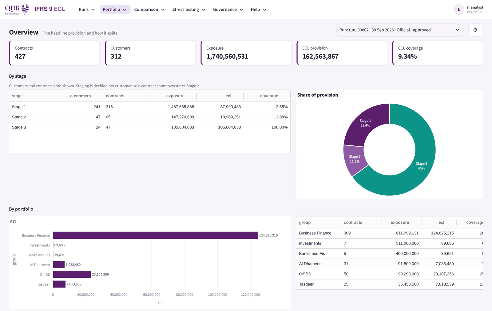

The menu bar is the same on every page.

| Menu | Pages | Use it to |
|---|---|---|
| **Runs** | Run the pipeline · Browse runs · Validation · Approval queue | produce a run, find one, check it, sign it off |
| **Portfolio** | Overview · Portfolio view · Staging · Risk parameters · Concentration · Segments · Scenarios · Data quality · ECL calculator | read one run |
| **Comparison** | Movement · Migration · Reconcile & export | compare two runs |
| **Stress testing** | Parameter stress · Macro data · Scenario library · Scenario stress | what-ifs, macro data and scenarios |
| **Governance** | Config versions · Calculator versions · Management overlay · Validation suppressions · Live configuration · Model assumptions · Audit log | control what produces a number |
| **Help** | Assistant · How this works (and these documents) | questions and reference |

At the right, the badge shows who is signed in and the engine version
(e.g. *n.analyst · engine 0.51.0*). The name is the one recorded in the audit
trail against everything you do.

## 2.2 The run selector

Most pages read **one run**, chosen in the drop-down at the top right of the
page: *Run: run_00002 · 30 Sep 2026 · Official · approved*. The label gives
the run id, the portfolio date, the run type and where it stands in approval.
The choice carries from page to page, so pick the run once.

Comparison pages add a second drop-down, **Against:**, for the run to compare
with (by default the previous run). The ⟳ button next to the selectors
re-reads the run from disk, which is only needed when a run was changed
elsewhere (an overlay applied, an approval recorded) while the page was open.

## 2.3 Tables

Tables are interactive. Click a column header to sort; the ☰ menu on a
header filters and hides columns. In a table that drives the page (the run
list, the overlay list, the customer list in the pipeline), **click a row to
select it**; the detail opens underneath. Most tables can be downloaded:
hover over the table and use the download icon at its top right, or the
**Download** button where the page offers an Excel export.

## 2.4 What every page has in common

- A title and a one-line description of what the page answers.
- Headline tiles (the boxes with large numbers) summarise the page; the
  charts and tables underneath explain them.
- Expanders (a line with ›) hold the detail: the figures behind a chart, the
  underlying rows, a how-to. Click to open.
- Nothing on a Portfolio, Comparison or Stress page changes a run. Pages that
  write something (pipeline, config versions, overlays, approval, macro data,
  suppressions) say so on the button.

# 3. A quarter-end, start to finish

The table lists the steps in the order they are usually done; each links to
the section that explains it.

| # | Step | Who | Where | Section |
|---|---|---|---|---|
| 1 | Refresh the macro store, or import the quarter's macro file | maker | Stress testing → Macro data | 6 |
| 2 | Create the quarter's config version from last quarter's | maker | Governance → Config versions | 5 |
| 3 | Update the forecasts and scenario weights in the draft; edit any reference table that changed | maker | Config versions → Edit config | 5.3–5.5 |
| 4 | Put the 12 extracts in the quarter's data-drop folder | maker / IT | the data-drop folder | 4 |
| 5 | Run an **unofficial** run on the draft's tested copy to check it | maker | Runs → Run the pipeline | 7 |
| 6 | Mark the config version tested | maker | Config versions → Manage | 5.6 |
| 7 | Approve the config version | checker | Runs → Approval queue | 8.3 |
| 8 | Run the **official** run on the approved version; add any overrides | maker | Run the pipeline | 7 |
| 9 | Read the validation; accept or fix findings | maker | Runs → Validation | 8.1 |
| 10 | Prepare any management overlay; check it; mark it tested | maker | Governance → Management overlay | 9 |
| 11 | Approve the run and the overlay | checker | Approval queue | 8.3 |
| 12 | Apply the approved overlay to the approved run | maker | Runs → Browse runs | 9.6 |
| 13 | Explain the movement against last quarter | maker | Comparison → Movement, Migration | 12 |
| 14 | Run the stress tests the committee asks for | maker | Stress testing | 13 |
| 15 | Package the run for audit | maker | Comparison → Reconcile & export, or Browse runs | 10.3 |

# 4. Input data: the 12 extracts

## 4.1 The files

A run reads twelve extracts from one folder. Each is found by its name; the
extension is not trusted, because the Oracle jobs sometimes write SQL*Plus
HTML with an `.xls` extension. The tool reads the first bytes of the file and
accepts **.xlsx, .xls, SQL*Plus HTML saved as .xls, and .csv**.

| File | One row per | Required columns (position if the header is truncated) |
|---|---|---|
| `AccountMaster` | lending contract | EXTRACTDA (1), CONTRACTID (2), CUSTOMERID (4), PORTFOLIOCODE (5), ACCOUNTTYPE (6), OPENDATE (9), PASTDUEDAYS (11), OFFBALANCE (17), ONBALANCE (18), MATURITYDATE (21); optional EIR (23), CCF (20), PAYMENTFREQUENCY (36), CURRENCYCODE (37), DEFERRALPERIOD (38), NOMINALINTERESTRATE (39), PAYMENTTYPEID (40) |
| `AccountMasterInvestments` | investment holding | EXTRACTDA, CONTRACTID, CUSTOMERID, PORTFOLIOCODE, ACCOUNTTYPE, OPENDATE, RATING (10), ONBALANCE, MATURITYDATE; optional EIR |
| `CustomerMaster` | lending customer | EXTRACTDA, CUSTOMERID (2), RATING (6); optional CUSTOMERNAME (4), PASTDUE_DAYS (7) |
| `CustomerMasterInvestments` | counterparty | CUSTOMERID (2); optional RATING (6), CUSTOMERNAME (4) |
| `CustomerStagingFlag` | lending customer | EXTRACTDA, CUSTOMERID (2), ISWATCHLIST (4), ISLOCAL1 (7); optional ISDEFAULT (3), ISINSOLVENCY (5), ISDEFAULTINGCC (6) |
| `CustomerStagingFlagInvestments` | counterparty | CUSTOMERID (2); flags optional |
| `Collateral` | collateral item | EXTRACTDA, COLLATERALID (2), collateral type id (4, often headed `CO`), currency (5, `COL`), COLLATERALVALUE (6) |
| `AccountCollateralAllocation` | allocation | EXTRACTDA, COLLATERALID (2), CONTRACTID (3), ALLOCATIONPERCENTAGE (4) |
| `RepaymentSchedule` | instalment | KEY_1 = contract id (1), POST_DATE (2), START_DATE (3), PRINCE_DUE (4), PROJ_INT (5), REPAYMENT (6), BALANCE (7) |
| `Origination` | lending contract | CONTRACTID or KEY_1 (2); optional PD12M, RATING, PASTDUEDAYS, ISWATCHLIST |
| `OriginationInvestments` | holding | CONTRACTID (2); optional rating |
| `IndustryCode` | customer | CUSTOMERID (1); optional INDUSTRYCODE (2), INDUSTRYDESCRIPTION (3) |

## 4.2 Accepted values and formats

| Kind | Accepted | Notes |
|---|---|---|
| Dates | `30/09/2026`, `09/30/2026`, `2026-09-30`, `30-Sep-2026`, `30-Sep-26`, `2026/09/30`, or a real Excel date | The format is chosen **per column** (the one that reads the most values), so 03/04/2026 cannot be March in one row and April in the next. |
| Amounts (ONBALANCE, OFFBALANCE, values, balances) | plain numbers, `1234567.89` | No thousands separators: `1,234.5` is reported as unreadable, not guessed. In QAR unless CURRENCYCODE says otherwise (converted with `fx_rates.csv`). |
| ONBALANCE for off-balance products | the **credit-equivalent exposure** (amount × CCF) | The engine applies no CCF of its own; OFFBALANCE carries the full face amount for reporting. |
| EIR | percent a year: `4.2` means 4.2% | Blank or 0 is filled from the product average (methodology §4.3). For investments a column above 1 is read as percent. |
| ALLOCATIONPERCENTAGE | percent: `100` means the whole item | Allocations of one collateral item may not add to more than 100. |
| Days past due | whole days, `0` or blank for current | |
| Flags (ISWATCHLIST, ISLOCAL1, ISDEFAULT …) | `1` = yes; `0` or blank = no | |
| PAYMENTFREQUENCY | months between instalments (1, 3, 6, 12); `0` or blank = bullet | |
| RATING | a grade on the master scale: `QDB 1+` … `QDB 10`, or Moody's `Aaa` … `C` for investments | A grade off the scale falls back (methodology §5.1). |
| Blank markers | empty, `NA`, `N/A`, `#N/A`, `NULL`, `NaN` | all read as blank |
| Junk rows | repeated SQL*Plus headers, the "N rows selected." trailer, total lines, blank rows, exact duplicates | removed on reading and counted in the validation report |

## 4.3 Where the files go

Three ways to give the pipeline its files (Section 7.2):

- **Data drop** — a dated sub-folder per quarter under the data-drop root,
  e.g. `data_drop/2026-09-30/`, holding the 12 files. The newest folder is
  offered first. This is the normal route.
- **Input folder** — the folder named in the configuration (`input_dir`).
- **Upload a zip** — a zip holding the 12 files, uploaded from your computer.
- **Another folder** — any folder path on the machine that runs the tool.

# 5. Configuration versions

*Governance → Config versions*

A **config version** freezes, under a label, everything a run is told apart
from the extracts: the macro forecasts and scenario weights, the PD model,
the rating scales, the mappings, the collateral haircuts, the staging
threshold. A run records the version it used, so the same quarter can be
re-run months later with exactly the same settings.

## 5.1 The lifecycle

| Status | Means | Which runs may use it | Can it be edited? |
|---|---|---|---|
| **draft** | being prepared | none | yes |
| **tested** | its maker has checked it and marked it tested; waiting for the checker | unofficial | no — copy it to a new draft |
| **approved** | a checker approved it | unofficial and official | no — copy it to a new draft |
| **rejected** | a checker rejected it | none | no — copy it to a new draft |
| **archived** | retired | none (kept for history) | no |

The page opens on four tiles (**Versions, Approved, Drafts, Tested, awaiting
approval**) and four tabs: **Versions** (the list and each version's files),
**Manage** (create, mark tested, archive), **Edit config** and **Compare**.

## 5.2 Create a version

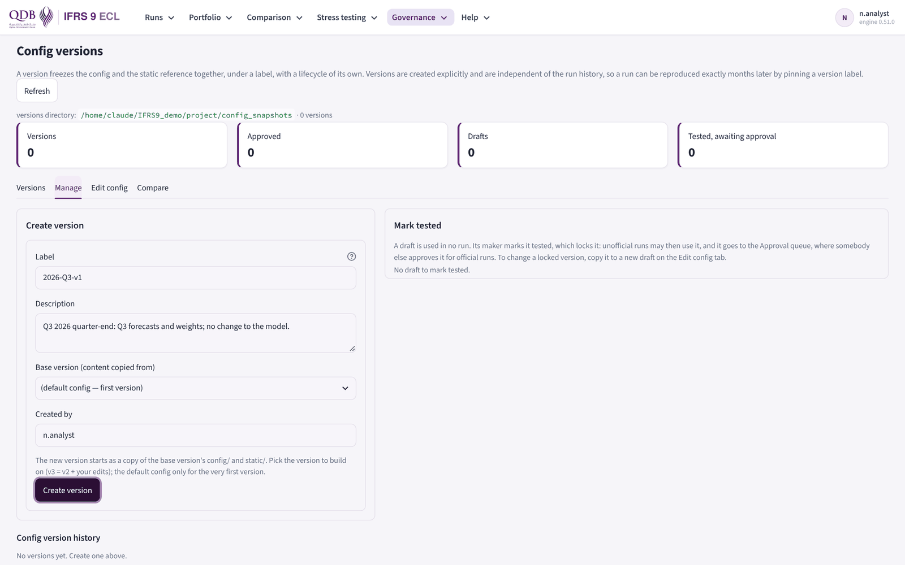

1. Open the **Manage** tab.
2. **Label** — a short unique name. Convention: `YYYY-Qn-vN`, e.g.
   `2026-Q4-v1`. Letters, digits, `-`, `_` and `.`; no spaces.
3. **Description** — one line on what changes, e.g. *Q4 2026 forecasts and
   weights; no change to the model*.
4. **Base version (content copied from)** — the version to build on, usually
   last quarter's approved version. Choose *(default config — first version)*
   only for the very first version.
5. **Created by** — your name (filled from the sign-in).
6. Press **Create version**. A green bar confirms *Created version: …*; the
   new version is a draft.

## 5.3 Edit a draft

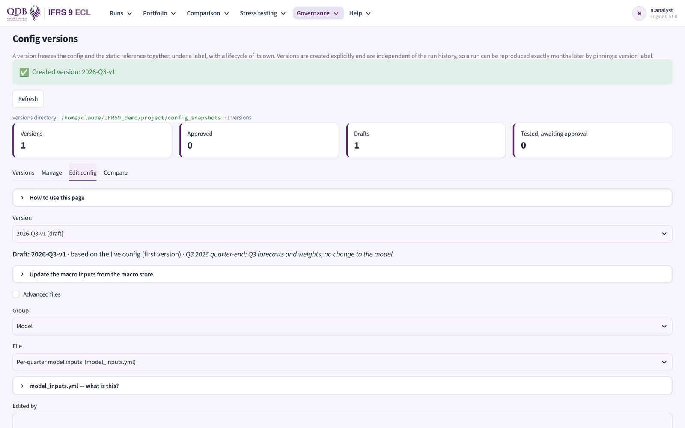

1. Open **Edit config** and pick the draft in **Version**. The line under it
   says what it is based on.
2. Choose the **Group** (Model, Rating scales, Mappings, Credit, Macro) and
   the **File**. Each file has a *— what is this?* expander. **Advanced
   files** shows the files that are a recalibration rather than a quarterly
   update (`model.yml`, `config.yml`); leave it off unless the model itself
   is changing.
3. Type your name in **Edited by**; every save is logged against it.

**A table (CSV file)** opens as an editable grid.

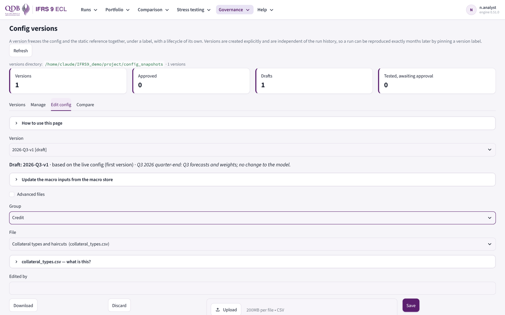

- Edit cells directly; add a row with the empty row at the bottom; delete a
  row by selecting it and pressing Delete.
- Or **Download** the file, edit it in Excel, and **Upload** it back. The
  upload must have **exactly the same columns in the same order**; otherwise
  it is refused with the list of expected columns. Comment lines starting
  with `#` at the top (the provenance header) are kept.
- **Save** writes the table into the draft; **Discard** throws away unsaved
  edits.

**A YAML file** (`model_inputs.yml`, `model.yml`, `config.yml`) opens as text.
**Save (validated)** saves only if the file still parses; on an error the file
on disk is not changed and the message gives the line and column.

## 5.4 What each file accepts

| File (group) | Columns / keys | Accepted values |
|---|---|---|
| Per-quarter model inputs `model_inputs.yml` (Model) | `mev_forecasts.forecasts`: years 1–5, each a list in the order of the model's variables (non-oil real GDP growth %, real-estate index growth %, domestic credit growth %); `internal_scenario_weights` / `external_scenario_weights`: `mode` (`auto` or `explicit`), `n_forecast_years`, `explicit_weights`; `external_gcc_country_growth` and `external_gcc_country_prices`: five values per GCC country | growth in **percent** (4.44 means 4.44%); weights as fractions that sum to 1 (0.4798); GDP at current prices in USD bn |
| PD model definition `model.yml` (advanced) | coefficients, standard deviations, MEV weights, TTC anchor PD, horizons, Stage 3 method, EAD fallback shapes | changing it is a recalibration |
| Run configuration `config.yml` (advanced) | paths, separation of duties, Stage 3 method, exposure cap | |
| Accepted findings `validation_suppressions.yml` | validator id, reason, approver, expiry | see Section 8.2 |
| Through-the-cycle PDs `ttc_pd_table.csv` (Rating scales) | `rating_type` (1 internal, 2 external), `rating`, `ttc_pd` | PD as a fraction (0.0122 = 1.22%); **a zero is valid and must be kept** |
| Rating scale `master_rating_scale.csv` | `rating`, `rating_type` (Internal / External), `external_equivalent`, `hierarchy` 1–21 | a grade is identified by type and grade together |
| Scenario severities `scenario_severity.csv` | `scenario`, `severity_z`, `description` | the five names must stay as they are; z as a number (−1.2816) |
| Portfolio register `portfolios.csv` (Mappings) | `portfolio_code`, `description`, `rating_type` | 1 = internal scale, 2 = external |
| Product → portfolio `product_portfolio_mapping.csv` | `product_type` (the ACCOUNTTYPE), `portfolio`, `source` | an unmapped product falls into **Business Finance** (the general book) and is flagged on Pricing readiness — check it belongs there |
| Off-balance product codes `off_balance_products.csv` | `product_code`, `lic_input_code` | |
| Industry → sector `industry_sector_mapping.csv` | `industry_code` (ISIC), `industry_description`, `sector` | unmapped codes drop out of sector analysis |
| Fallback ratings `segment_fallback_ratings.csv` | `segment`, `fallback_rating` | grades on the scale (QDB 5, QDB 6, Baa3) |
| Collateral types and haircuts `collateral_types.csv` (Credit) | `collateral_type_id`, `external_collateral_type`, `description`, `haircut_general` | haircut as a fraction: 0 = full value counts, 0.5 = half, 1 = nothing counts. **An unmapped type counts for nothing.** |
| Staging thresholds `staging_thresholds.csv` | `dpd_stage2_threshold_days` (60), `maturity_extension_days` (365) | whole days |
| Collective assessment ladder `collective_assessment_rules.csv` | `sector`, `dpd_threshold`, `rating` | the grade from that many days past due upward |
| FX rates `fx_rates.csv` | `currency_code`, `fx_rate` | QAR per unit (USD 3.645); QAR = 1 |
| Non-oil GDP history, GCC real GDP growth, GCC GDP at current prices (Macro) | `year`, `value` (or country columns) | growth in percent; the GCC series start in 1982 |

## 5.5 Update the macro inputs from the macro store

Instead of typing forecasts into `model_inputs.yml`, open **Update the macro
inputs from the macro store** at the top of a draft (the same panel is on
*Macro data → Config update*, Section 6.6). It writes a rating model's
variables, its 5-year forecast and its history from the latest macro vintage
into the draft:

- tick **Internal rated model** and/or **External rated model**;
- tick **Keep the current scenario weights** for a model to leave its weights
  as they are; leave it unticked to recompute them from the new forecast;
- press **Propose**: the proposed forecast, history and weights are shown
  beside the current ones (*Nothing moves* where a value is unchanged);
- press **Write into the draft**.

What is not ticked stays as it is.

## 5.6 Mark tested

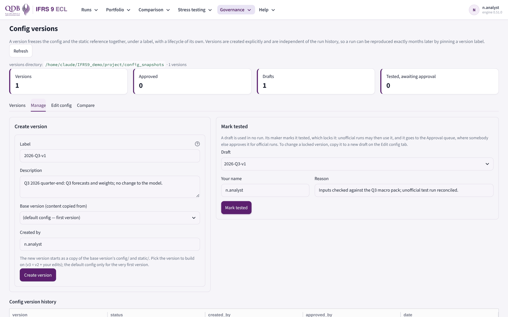

When the draft is complete and an unofficial run on it has been checked:

1. **Manage** tab → **Mark tested**.
2. Pick the **Draft**, type **Your name** and a **Reason** (e.g. *Inputs
   checked against the Q3 macro pack; unofficial test run reconciled*). Both
   are required.
3. Press **Mark tested**. The version is locked and appears on the Approval
   queue for the checker (Section 8.3).

## 5.7 Change a locked version

A tested, approved or rejected version is never edited. On **Edit config**,
pick it, fill **New label**, **Description** and **Created by** under **Copy
to a new draft**, and press **Copy to a new draft**. The copy keeps the
lineage (its parent is recorded).

## 5.8 Compare and archive

- **Compare** — pick **From** and **To**; the tab lists every file that
  differs and the changed rows or lines. Use it to show a reviewer exactly
  what a new version changes.
- **Archive an approved version** (Manage) — retires a version with a reason.
  An archived version stays on disk and in the history; runs that used it
  still reproduce.
- **Config version history** (Manage) lists every transition: who, when, from
  which status to which, and why.

# 6. Macro data

*Stress testing → Macro data*

The macro store keeps every macro series the tool uses, in dated **vintages**
that are never overwritten. It feeds three things: the config update
(forecasts and history into a config version), the linked effects that
scenarios use, and the scenario library's historical episodes.

## 6.1 Store

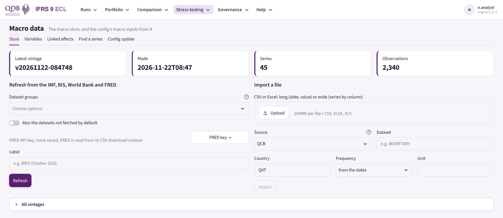

The tiles show the **Latest vintage** (e.g. `v20261122-084748`), when it was
**Made**, and how many **Series** and **Observations** it holds.

**Refresh from the IMF, BIS, World Bank and FRED**

1. **Dataset groups** — leave empty for every dataset marked for fetching, or
   pick groups.
2. **Also the datasets not fetched by default** — adds the optional ones.
3. **FRED key** — optional. Without a key FRED is read from its CSV download;
   a key saved here is kept on this computer only, never in the code.
4. **Label** — a name for the vintage, e.g. *WEO October 2026*.
5. Press **Refresh**. A progress bar shows each dataset; at the end a green
   bar gives the vintage, series and value count. A dataset that fails keeps
   its previous copy and is listed in a warning.

**Import a file** (for QCB, Planning and Statistics Authority or Ministry of
Finance data, or anything not fetched automatically)

| Field | Accepts |
|---|---|
| File | CSV, XLSX or XLS, up to 200 MB. **Long** layout: a `date` column and a `value` column (one series per file). **Wide** layout: a `date` column and one column per series. |
| Dates | years (`2025`), quarters (`2025Q3`) or full dates |
| Source | QCB, NPC (Planning and Statistics Authority), MOF, IMF, OTHER |
| Dataset | a short name, e.g. `MONETARY` (required) |
| Country | ISO-3 code, default `QAT` |
| Frequency | A, Q or M, or *from the dates* |
| Unit | free text, e.g. `% change`, `QAR m` |

Press **Import**; the file becomes a new vintage. **All vintages** lists
every vintage with its date and size.

## 6.2 Variables

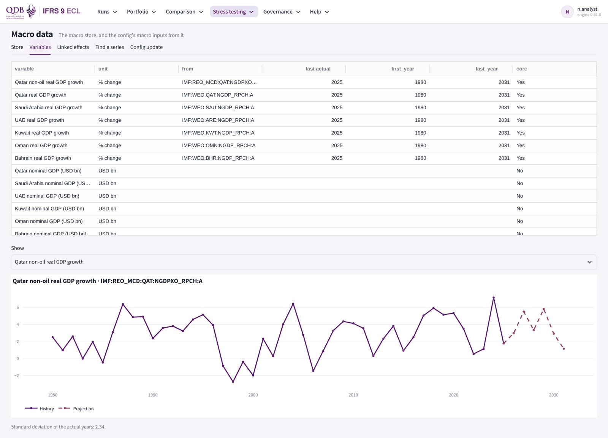

A table of the variables the tool knows (label, unit, the series behind it,
last actual, first and last year). **Show** picks one to chart: history as a
solid line, the projection dashed, with the standard deviation of the actual
years underneath — the unit a "1 standard deviation" stress is measured in.

## 6.3 Linked effects

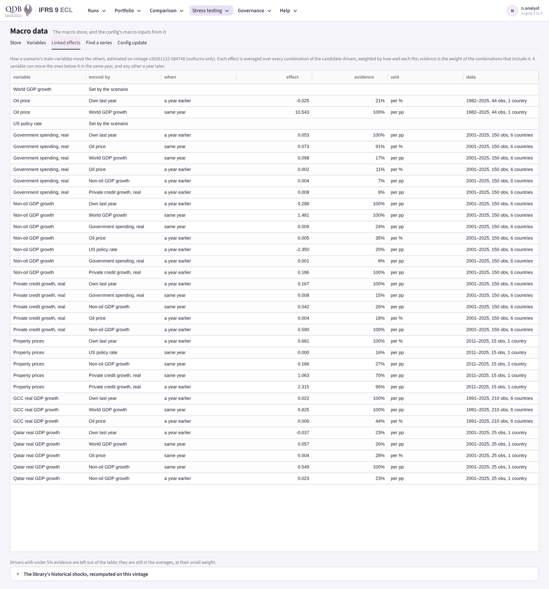

How a scenario's main variables move the others, estimated on the latest
vintage (outturns only). Each row reads: *variable* is moved by *driver*,
*when* (same year or a year earlier), by *effect* per unit of the driver,
with *evidence* (the weight of the model combinations that include that
driver; drivers under 5% are not listed) and the *data* used (years,
observations, countries). For example *Non-oil GDP growth · World GDP growth
· same year · 1.481 · 100%* means a 1-point fall in world growth takes about
1.5 points off Qatar's non-oil growth the same year. **The library's
historical shocks, recomputed on this vintage** shows the library episodes
re-derived from these effects.

## 6.4 Find a series

Search the store by text, **Country** and **Source**; **Show** charts a hit.
Use it to check what a vintage actually holds before relying on it.

## 6.5 Config update

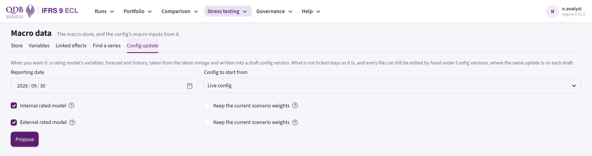

Writes a rating model's variables, forecast and history from the latest
vintage into a draft config version.

1. **Reporting date** — the quarter-end the forecast is for; Year 1 is the
   year of this date.
2. **Config to start from** — *Live config* or an existing version.
3. Tick **Internal rated model** and/or **External rated model**, and
   **Keep the current scenario weights** for each if the weights should not
   move.
4. **Propose** — shows the proposed forecasts, history and weights next to the
   current ones, and the vintage they come from.
5. **Write into the draft** — writes them into a draft (if you started from
   a draft, into that one). Then continue on Config versions (Section 5.3).

# 7. Running the ECL

*Runs → Run the pipeline*

The pipeline page takes a run from the 12 files to a finished, recorded run
in four stages: **settings and inputs → check → review (overrides) →
finish**. The three buttons of the **Check and start** card do the first part
in order: **Validate inputs**, **Pre-run check**, **Start official run** (or
**Start unofficial run**). Each is enabled when the one before has passed;
changing a setting or the inputs sends you back a step. Nothing is written to
the run history until the run is started.

## 7.1 Settings

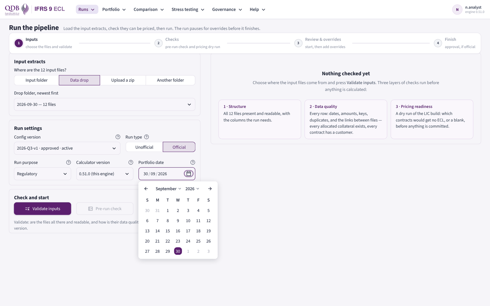

| Field | Choices | Notes |
|---|---|---|
| **Config version** | approved and tested versions, plus *Default config (as on disk)* | Drafts are not offered. The ⓘ shows the version's status and description. |
| **Run type** | **Unofficial** / **Official** | *Unofficial*: testing and what-if; no approval; exports marked UNOFFICIAL. *Official*: the deliverable; needs an **approved** config version and a checker's approval. If the version is not approved an amber box says *An official run cannot start* and why. |
| **Run purpose** | official: *Regulatory*; unofficial: *Non-regulatory*, *Impact analysis* | Every run is priced on the weighted curve and on each scenario either way. |
| **Calculator version** | *this engine*, or an archived version | An archived calculator runs that version's frozen code, to reproduce an old run exactly. |
| **Portfolio date** | dd/mm/yyyy | Filled automatically from the extracts' EXTRACTDA when they are validated. |

## 7.2 Inputs

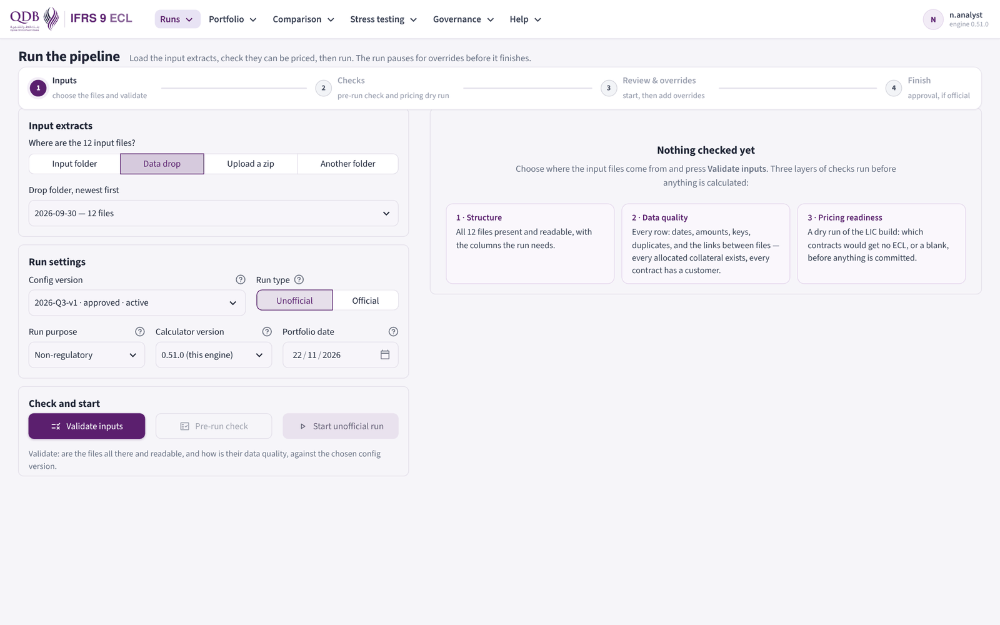

1. Under **Where are the 12 input files?** choose **Input folder**, **Data
   drop**, **Upload a zip** or **Another folder** (Section 4.3).
2. For a data drop, pick the quarter's folder; the card lists the 12 files it
   found and flags any missing one.
3. Press **Validate inputs** (in the *Check and start* card). The tool reads every file and checks it against
   the input schema; the card turns green (*valid*) or red (*N problem(s)*),
   and the portfolio date is filled from the extracts.

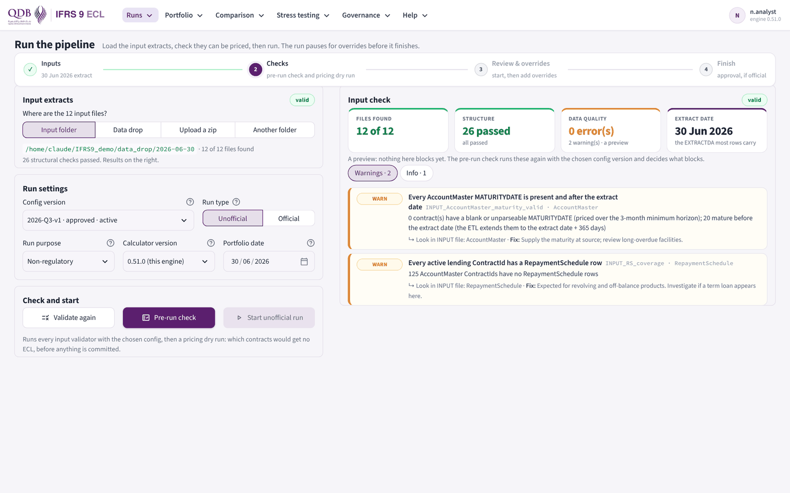

A file problem (missing file, missing required column, unreadable dates)
stops here: fix the extract and press **Validate again**.

## 7.3 Check

Press **Pre-run check**. The tool prepares every contract exactly as
the run would (ratings, staging inputs, EAD, collateral) without pricing, and
reports:

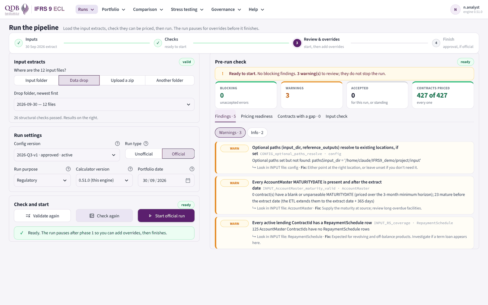

- **Findings** — every validation finding, by severity: *Errors* (block an
  official run), *Warnings*, *Info*, and *Accepted* (matched by a validation
  suppression, Section 8.2). Each row gives the check, how many rows it hits,
  and an example.
- **Pricing readiness** — the exposure that would get **no ECL or a blank**
  (a contract with no PD curve for its portfolio and grade, or no EIR),
  and the exposure priced on incomplete inputs. The headline says *every
  one* when nothing is lost.
- **Contracts with a gap** — the contracts behind those numbers, one row each
  with the reason. Download it and send it to the data owner.
- **Input check** — row counts kept and dropped per file.

The start button stays disabled, with a red *Start is locked* box, while
there is a blocking finding or the official-run gate is not met. Some
blocking findings can be **accepted for this run only**: press **Accept for
this run…**, tick the **Findings to accept**, type a **Reason (required)**
(e.g. *Schedule dates carry two-digit years in the source; IT ticket #1234;
accepted pending the re-extract*) and **Accepted by**, and press **Accept for
this run and re-check**. The acceptance is recorded on the run and in the
audit trail; the next run asks again. Use it for a known source issue the run
has to live with, never to get past a real error — for a finding that is
expected every quarter, use a validation suppression (Section 8.2). Findings
that cannot be accepted must be fixed at source.

## 7.4 Review and overrides

After **Start official run** / **Start unofficial run** the engine prices the book (about half a minute for
the demonstration book; a progress bar shows the step). The run then pauses
at **Review** so that overrides can be added before the outputs are written.

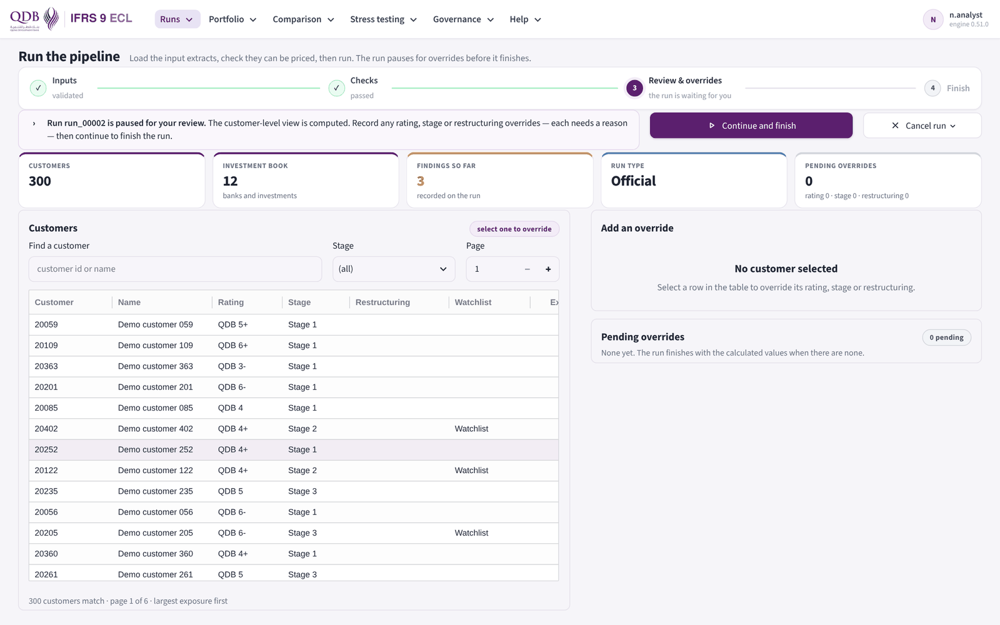

A blue box says *Run run_0000N is paused for your review.* An **override**
changes one customer's rating, stage or restructuring status for this run,
with a reason. It is recorded on the run and in the audit trail, and the
checker sees it on the Approval queue.

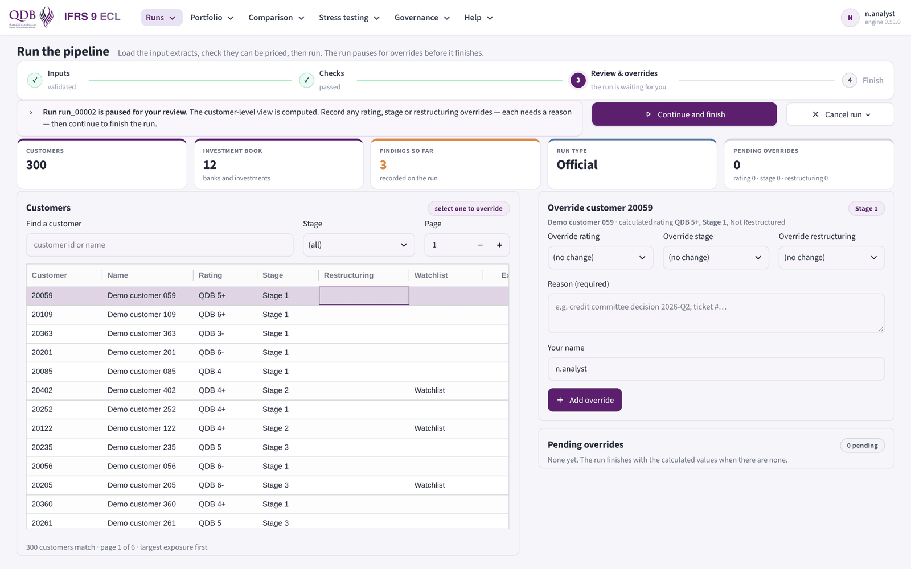

1. In **Customers**, type in **Find a customer** (id or name), or narrow the
   list with **Portfolio** (one or more of Business Finance, Off BS, Al
   Dhameen, Tasdeer, Investments, Banks and Fis — a customer with contracts in
   two portfolios shows under both) and **Stage**. The list holds the lending
   customers and the investment counterparties, ordered largest exposure
   first, 50 a page. It shows each customer's **Book** (*Lending* or
   *Investments*), **Portfolio** (every portfolio its contracts sit in, e.g.
   *Business Finance, Off BS*), rating, stage, restructuring, watchlist,
   exposure and worst DPD. Click the row.

   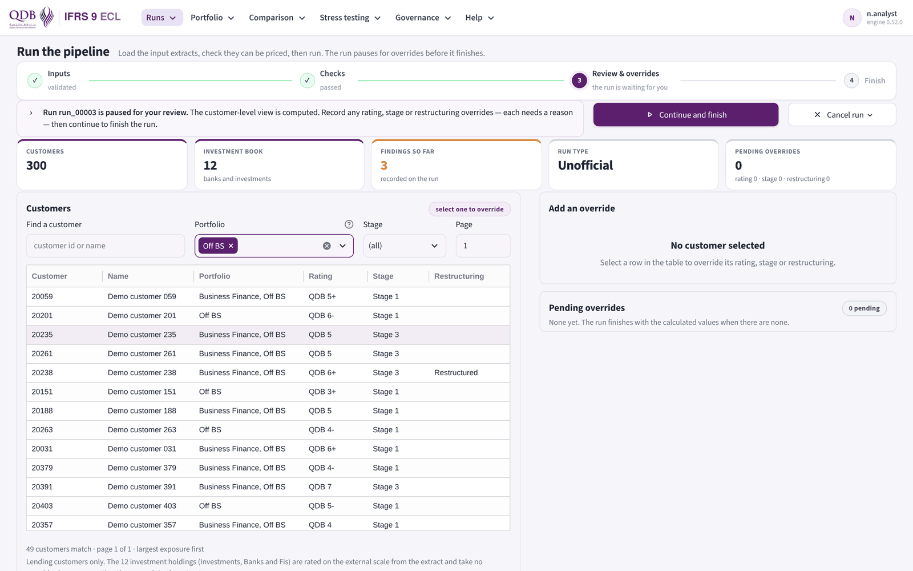

   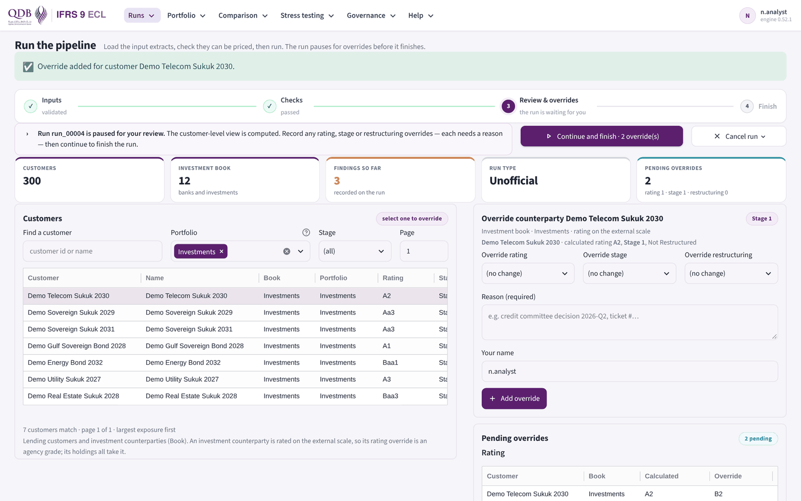

2. The card **Override customer …** (or **Override counterparty …** for an
   investment) shows the calculated rating, stage and restructuring. Set any of **Override rating**, **Override stage**,
   **Override restructuring** (leave the others at *(no change)*).
3. Type a **Reason (required)** — e.g. *Credit committee decision CC-2026-114,
   restructured September 2026* — and **Your name**.
4. Press **Add override**. It appears in the overrides table; **Remove**
   takes one out.

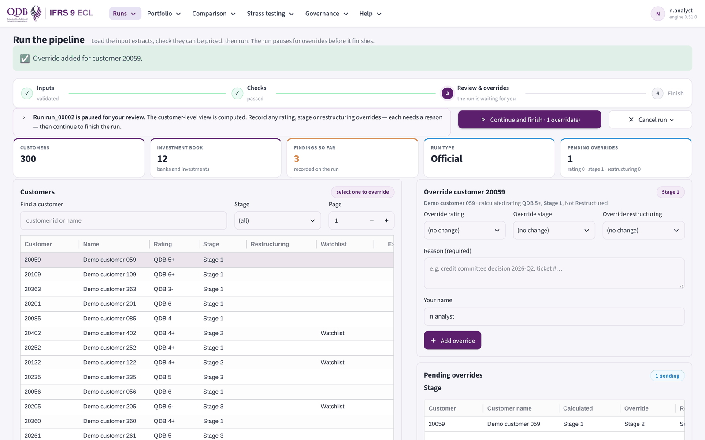

Rules the engine enforces:

- both books can be overridden. An **investment counterparty** (Investments,
  Banks and Fis — the extract's CUSTOMERID, which is its name) takes a rating
  on the **external scale** (Aaa … C), applied to all its holdings; its stage
  and restructuring overrides go into the investment staging file. Every
  override records its book, so a counterparty is never mistaken for a
  lending customer;
- a stage override can only **worsen** the stage (Stage 1 → 2 or 3, Stage 2
  → 3); a customer in **Stage 3 cannot be overridden** — an override cannot
  cure a default;
- a lending rating override is a grade on the internal scale (QDB 1+ …);
  a restructuring override flips what the model calculated;
- an earlier (archived) calculator version cannot take investment overrides:
  the run refuses to continue until they are removed;
- a stage or rating override applies to all of the customer's facilities,
  because both are decided per customer.

## 7.5 Finish

Press **Continue and finish** (it shows how many overrides are pending). The engine applies the overrides, re-prices the
customers affected, writes the outputs and records the run.

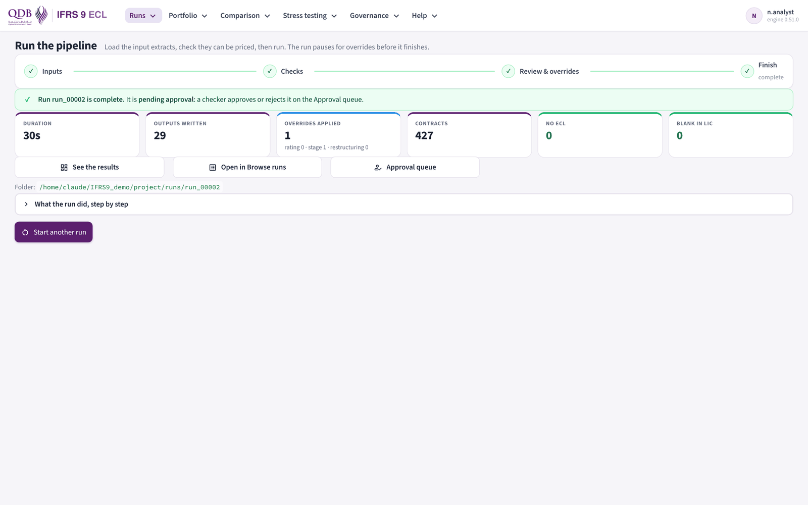

A green box says *Run run_0000N is complete* with the headline ECL, exposure
and coverage and the run folder. An official run is now **pending approval**
on the Approval queue; an unofficial run is complete. **Start another run**
clears the page for the next one.

**If something goes wrong**: a run that fails during pricing leaves nothing
in the history; the error is shown in a red box with the step it failed at.
A paused run survives a page refresh or a closed browser: the pipeline page
offers it again with **Resume**. **Cancel run → Cancel the run** abandons it;
its partial folder is removed and nothing is priced.

# 8. Validation and approval

## 8.1 Validation

*Runs → Validation* (for the run chosen at the top)

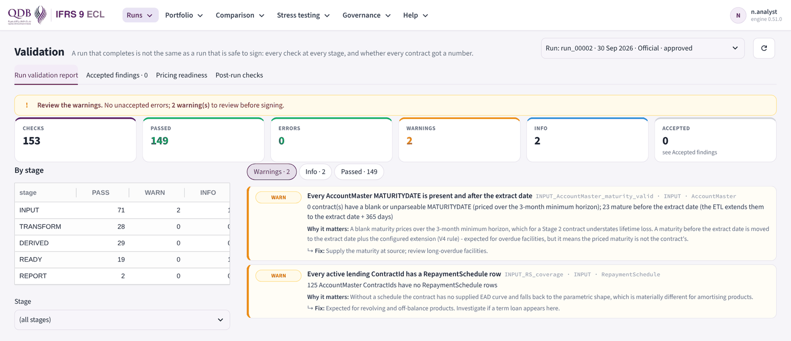

A banner gives the verdict first, e.g. *Review the warnings. No unaccepted
errors; 2 warning(s) to review before signing.* Tiles count the **Checks**,
**Passed**, **Errors**, **Warnings**, **Info** and **Accepted**.

| Tab | Shows |
|---|---|
| **Run validation report** | every check at every stage of the run (inputs, cleaning, transformation, cross-file, readiness, report), counted by stage. Each failed check shows its severity, id (e.g. `INPUT_RS_coverage`), what it found, **Why it matters** and **↳ Fix**. |
| **Accepted findings · N** | failed checks matched by a validation suppression, with its reason, approver and expiry |
| **Pricing readiness** | whether every contract got a number: *Every contract is priced* or the exposure with no ECL |
| **Post-run checks** | the checks that can be re-run from the run folder alone (useful for a run copied in from elsewhere), with a PASS / FAIL verdict |

Severity: **ERROR** blocks an official run until fixed or accepted; **WARN**
must be reviewed before signing; **INFO** is for information (e.g. customers
rated by the collective rule or a fallback).

A finding that is understood and not an error in the data (e.g. a known
product that has no collateral by design) can be **accepted** with a
suppression rather than left to be explained every quarter.

## 8.2 Validation suppressions

*Governance → Validation suppressions*

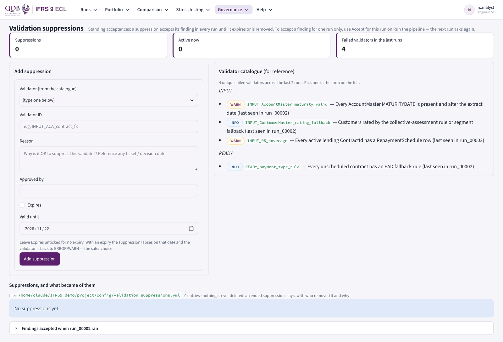

A suppression accepts a validator: its failures move from ERROR / WARN to
*Accepted* in later runs. The page lists the **Suppressions**, those
**Active now** and the **Failed validators in the last runs**.

**Add suppression**

| Field | Accepts |
|---|---|
| **Validator (from the catalogue)** | pick one of the validators that failed in recent runs (listed at the right with severity and when last seen); fills the id |
| **Validator ID** | the id, e.g. `INPUT_RS_coverage` |
| **Reason** | required: why the finding is expected, e.g. *Revolving and off-balance products have no schedule by design* |
| **Approved by** | the approver's name |
| **Expires** / **Valid until** | tick **Expires** and give a date (dd/mm/yyyy) for the suppression to lapse; unticked = no expiry. An expiry is the safer choice. |

Nothing is ever deleted: an ended suppression stays in the list with who
removed it and why. Suppressions live in `validation_suppressions.yml`, which
is frozen into each config version.

## 8.3 Approval queue

*Runs → Approval queue* (the checker's page)

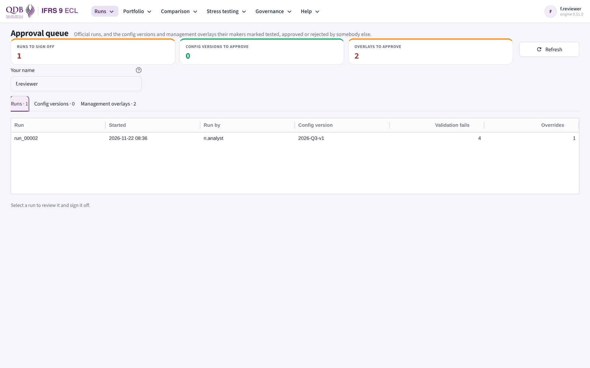

Three tiles count what is waiting: **Runs to sign off**, **Config versions to
approve**, **Overlays to approve**; three tabs hold them.

**To approve a run**

1. Type **Your name** (it must differ from the maker's when separation of
   duties is on).
2. On **Runs**, click the run. Three tabs show what you are signing:
   **Validation** (its findings), **Overrides** (every override, its reason
   and who added it) and **Outputs** (the headline figures by stage and
   portfolio).

   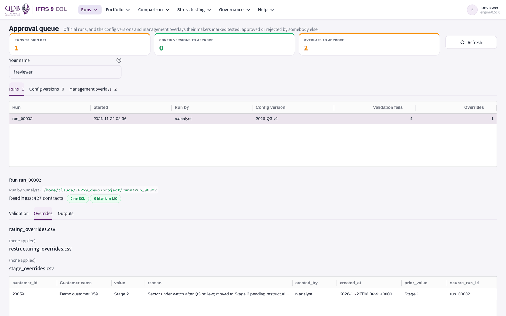

3. Type a **Reason** (required) and press **Approve** or **Reject**.

**To approve a config version** — on **Config versions**, click the version;
the list shows its description, maker, tester, when it was tested and what it
is based on. Compare it on Config versions → Compare if needed; type a
**Reason** and press **Approve** or **Reject**.

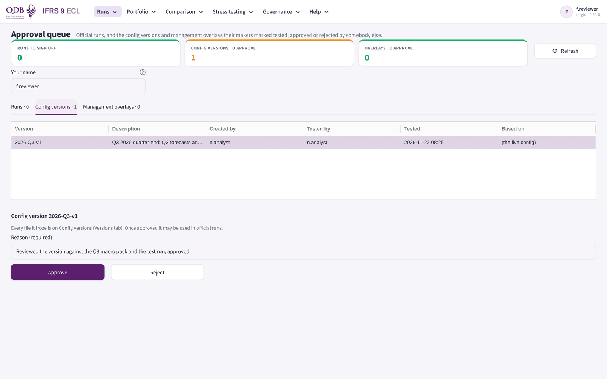

**To approve an overlay** — on **Management overlays**, click it; its rules,
reason and checked impact are shown. **Approve** or **Reject** with a reason.

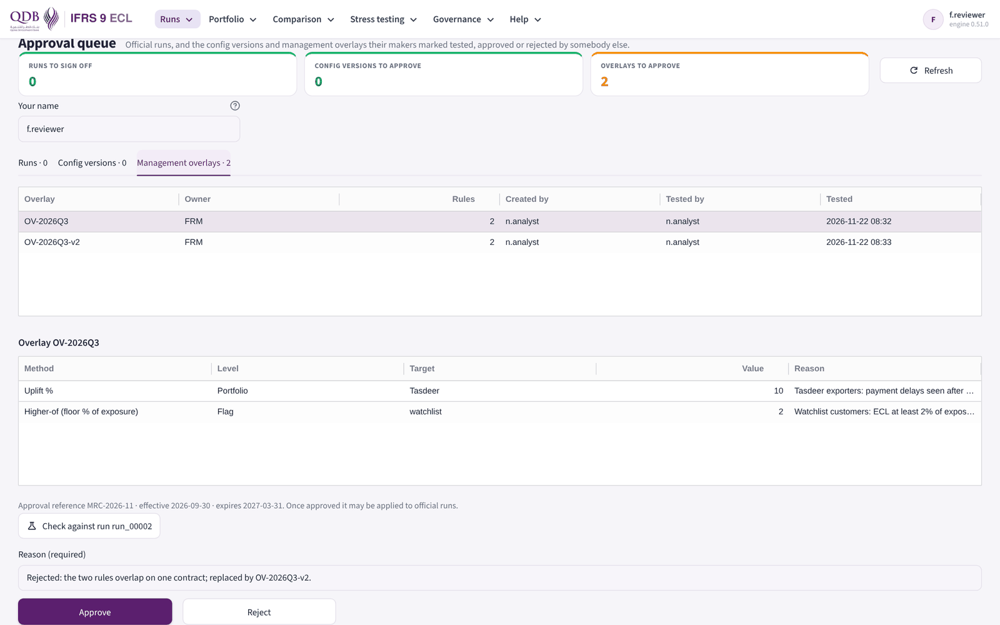

Every decision is written to the audit log with the name, time and reason.

# 9. Management overlays

*Governance → Management overlay*

An overlay is a post-model adjustment to the provision, for a risk the model
does not capture. It never changes the model's output file: applied to a run,
it writes a second report beside it (`FinalEclReport_overlay_<id>.csv`), and
the pages show model ECL, overlay and total.

## 9.1 The lifecycle

Overlays follow the same lifecycle as config versions: **draft → tested →
approved / rejected**. Only an approved overlay can be applied to an official
run; an unofficial run accepts tested ones too. A locked overlay is changed by
copying it to a new draft, e.g. `OV-2026Q3-v1` → `OV-2026Q3-v2`.

## 9.2 Create an overlay

The page opens with tiles (**Overlays, Approved, Drafts, Tested, awaiting
approval**), the expander **Values and targets** (a reminder of what to type
in each rule), **New overlay**, and the list of overlays.

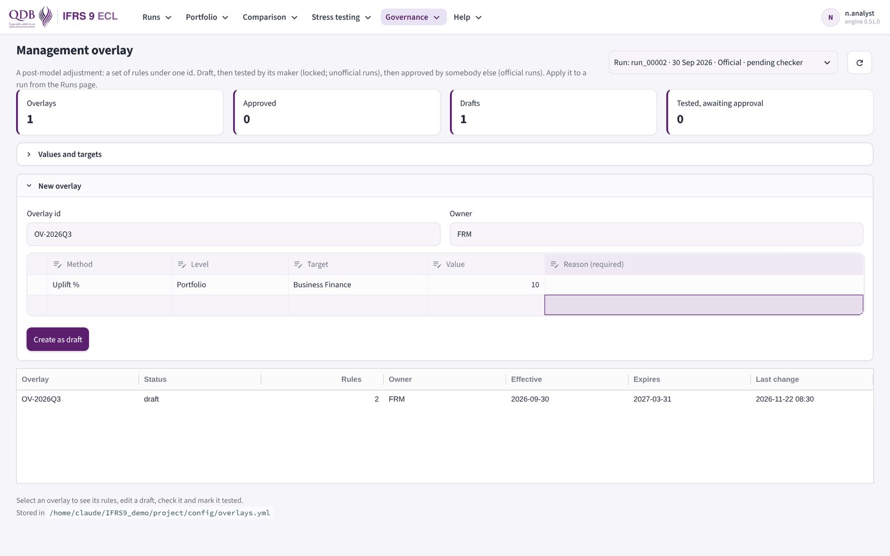

1. Open **New overlay**.
2. **Overlay id** — unique, e.g. `OV-2026Q4` (letters, digits, `-`, `_`).
   **Owner** — the owning team, default `FRM`.
3. Fill the rules grid (next section): one row per rule; the empty row at
   the bottom adds another.
4. Press **Create as draft**. An overlay with no id, an id that exists, or no
   rule is refused with the reason.
5. Select the new draft in the list. Fill **Approval reference** (e.g. the
   credit committee minute), **Effective from** and **Expires** (dates as
   `2026-12-31`), check every rule has a **Reason**, and press **Save**. A rule
   without a reason is refused.

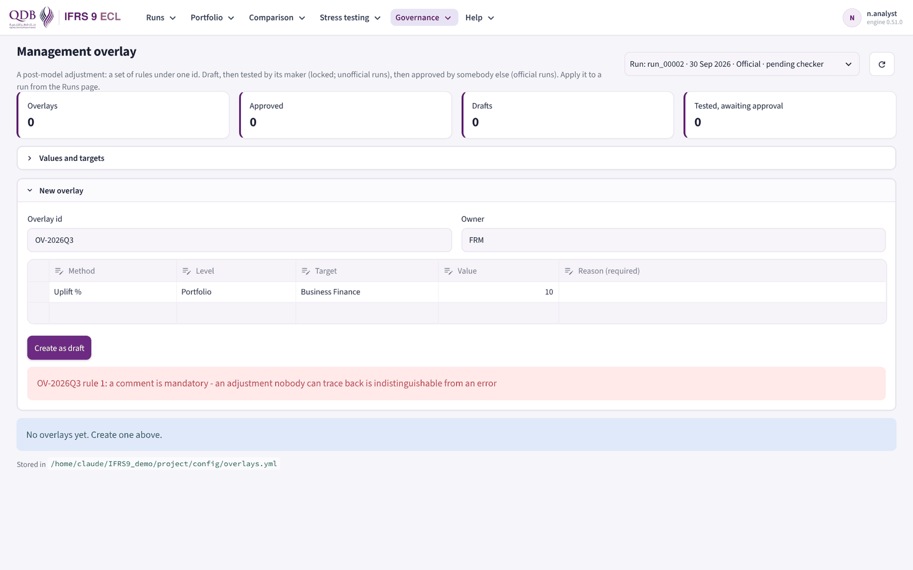

## 9.3 Rules: what each field accepts

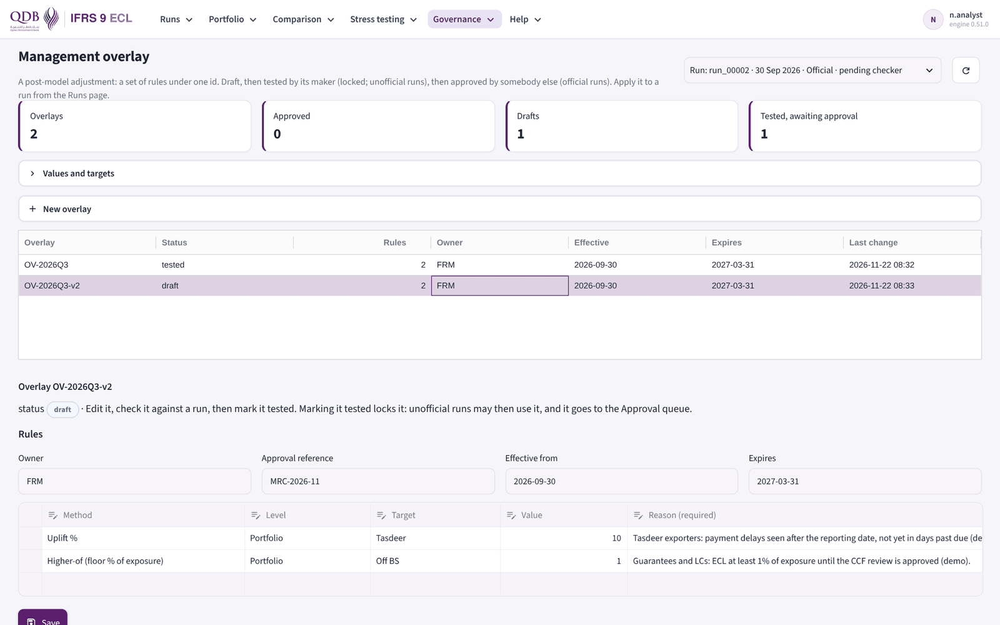

| Column | Accepts |
|---|---|
| **Method** | *Uplift %*, *Higher-of (floor % of exposure)*, *Absolute add (QAR)* |
| **Level** | *Whole book*, *Stage*, *Portfolio*, *Rating*, *Flag*, *Sector*, *Customer*, *Contract* |
| **Target** | depends on the level — see the next table |
| **Value** | Uplift: percent of model ECL (`15` = +15%). Higher-of: the floor as a percent of exposure (`5` = 5%). Absolute add: QAR. |
| **Reason** | required for every rule |

| Level | Target to enter |
|---|---|
| Whole book | nothing: every Stage 1 and 2 contract |
| Stage | `1` or `2` (Stage 3 is never touched) |
| Portfolio | Business Finance, Off BS, Al Dhameen, Tasdeer, Investments, Banks and Fis |
| Flag | watchlist, default, default_gcc, insolvency, local1 … local6 |
| Rating | grades, e.g. `QDB 7, QDB 8` |
| Customer | customer ids, comma-separated |
| Contract | contract ids, comma-separated |
| Sector | the report carries no sector, so this level currently matches nothing (as in the R tool) — use Customer for a sector overlay |

| Method | Overlay ECL for each matched contract |
|---|---|
| Uplift % | model ECL × (1 + value / 100) |
| Higher-of | max(model ECL, value / 100 × exposure) |
| Absolute add | model ECL + value, spread over the matched contracts by exposure |

Stage 3 contracts are never adjusted (they are already at 100%), and the
overlaid ECL is never above the balance. **Two rules may not hit the same
contract**: overlapping rules are refused when the overlay is checked or
applied, with the contracts they share.

## 9.4 Check the impact

With a run chosen at the top of the page, press **Check against run
run_0000N**. It uses the rules as they stand in the grid, saved or not.

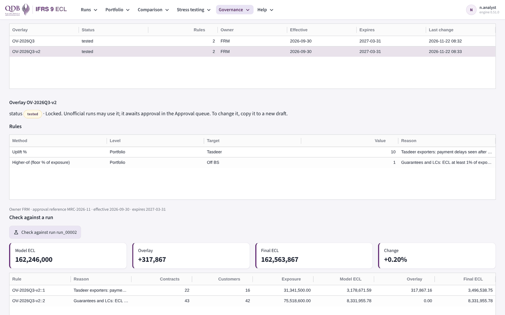

Tiles: **Model ECL**, **Overlay**, **Final ECL** and **Change** (%). The
table gives, per rule, its reason, the contracts and customers it matched,
their exposure, model ECL, overlay and final ECL. A rule that matches nothing
(a mistyped target) shows zero contracts — check the targets before marking
tested.

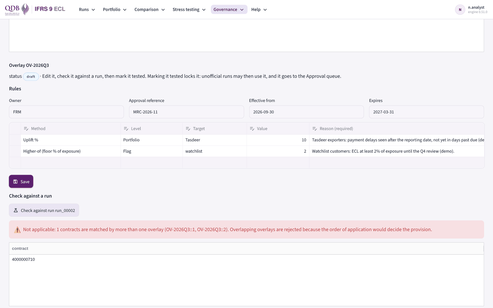

## 9.5 Mark tested, approve, copy

1. Select the draft, type **Your name** and a **Reason**, press **Mark
   tested**. The overlay is locked; unofficial runs may now use it and it goes
   to the Approval queue. *Check the impact first*: marking tested does not
   itself run the check, so an overlap is caught only at check or apply.
2. The checker approves or rejects it (Section 8.3).
3. To change a locked overlay, type a **New overlay id** (e.g.
   `OV-2026Q4-v2`) and press **Copy to a new draft**. A draft can be deleted
   with **Remove**.

## 9.6 Apply to a run

*Runs → Browse runs* → select the run → **Management overlay** card

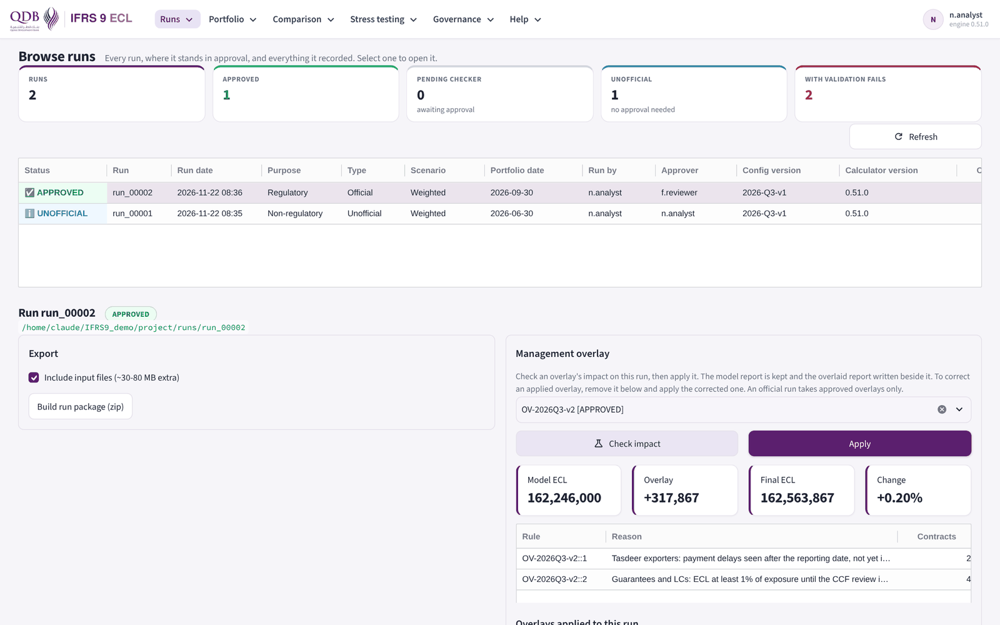

1. Choose it in **Overlay** (an official run lists
   approved overlays only).
2. **Check impact** shows what it would add.
3. **Apply** writes the overlaid report. A green bar reads e.g.
   *OV-2026Q3-v2 [APPROVED] applied: model 162,246,000 + overlay 317,867 =
   162,563,867*.

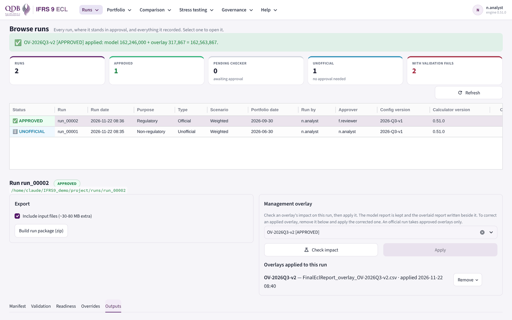

**Overlays applied to this run** lists each with its file and time. To
correct one, **Remove** it and apply the corrected version; one overlay per
run is in force at a time. The Portfolio pages and Movement show the overlay
as a separate figure (e.g. *coverage 9.34% · overlay 317,867*) and as its own
bar in the movement bridge.

# 10. Finding and packaging runs

## 10.1 Browse runs

*Runs → Browse runs*

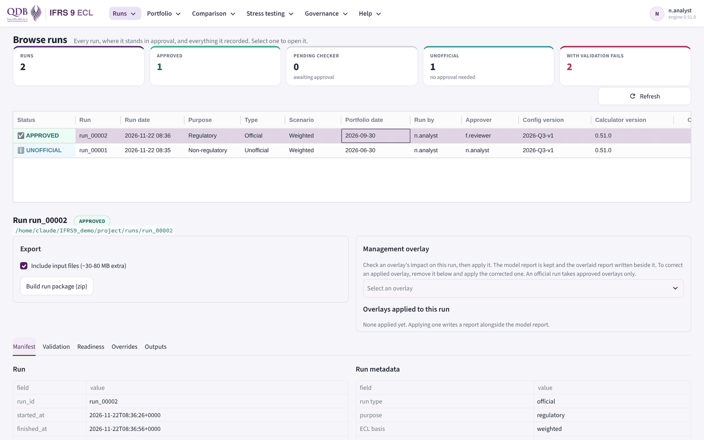

Tiles: **Runs**, **Approved**, **Pending checker**, **Unofficial**, **With
validation fails**. The table lists every run: status, run id, run date,
purpose, type, scenario basis, portfolio date, run by, approver, config
version, calculator version. Click a run to open it.

| Tab | Shows |
|---|---|
| **Manifest** | the run's identity: id, start and finish, type, purpose, ECL basis, config version and its fingerprint, calculator version, input files and their checksums |
| **Validation** | the run's findings |
| **Readiness** | pricing readiness at the time of the run |
| **Overrides** | every override with reason and maker |
| **Outputs** | the output files and the headline figures |

## 10.2 Run status

| Status | Means |
|---|---|
| ✅ APPROVED | official, approved by a checker |
| ⏳ PENDING | official, waiting for the checker |
| ❌ REJECTED | official, rejected; rerun after fixing |
| ℹ UNOFFICIAL | unofficial; no approval needed |

## 10.3 Export a run package

On the run, in the **Export** card: tick **Include input files (~30–80 MB
extra)** if the source extracts should go too → **Build run package (zip)** →
**Download ifrs9_run_run_0000N.zip**. Everything needed to defend the figure
goes in, under one folder named after the run: the LIC input files, the
report (and any overlaid report), the frozen configuration, the validation
result, the approvals and the audit trail, with a README listing each file
and what it is for. The raw extracts are **off by default**: they are large
and hold customer data, so including them should be a decision. A run that is
pending or rejected cannot be packaged; only approved and unofficial runs.
The same package is offered on *Comparison → Reconcile & export → Export*.

# 11. Reading a run: the Portfolio pages

All Portfolio pages read the run chosen at the top right. The figures include
the overlay where one is applied, and say so (*· overlay*).

## 11.1 Overview

- **Tiles** — Contracts, Customers, Exposure, ECL provision, ECL coverage
  (ECL ÷ exposure).
- **By stage** table — customers, contracts, exposure, ECL and coverage per
  stage. Customers and contracts are both shown because staging is decided
  per customer: a customer with three facilities in Stage 2 counts once in
  customers and three times in contracts.
- **Share of provision** donut — each stage's share of the ECL. Stage 3 is
  usually most of it, because it is provisioned at 100% of the balance.
- **By portfolio** — ECL per portfolio as a bar chart and a table (contracts,
  exposure, ECL, coverage).

**What to check**: coverage by stage should rise steeply from Stage 1 to 3
(e.g. 2.6% → 12.9% → 100%). A Stage 2 coverage close to Stage 1 suggests the
lifetime horizon is not being applied.

## 11.2 Portfolio view

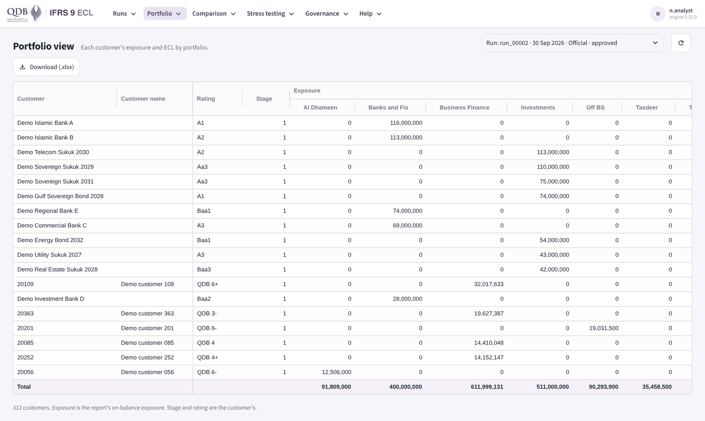

One row per **customer** (312 in the demonstration run) with exposure and
ECL in each portfolio, the customer's stage and rating. Exposure is the
report's on-balance exposure; stage and rating are the customer's, since both
are set per customer. Sort and filter the grid, or **Download (.xlsx)** for
the whole list — the usual starting point for a customer-level query.

## 11.3 Staging

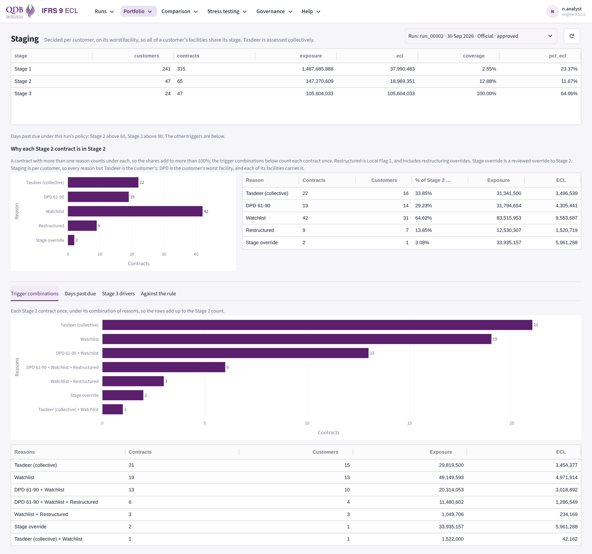

- **Stage table** — customers, contracts, exposure, ECL, coverage and share of
  the ECL per stage.
- **Why each Stage 2 contract is in Stage 2** — bar chart and table by
  trigger: Tasdeer (collective), DPD 61–90, Watchlist, Restructured (local
  flag 1, including restructuring overrides), Stage override. A contract with
  more than one trigger counts under each, so the shares add to more than
  100%.
- **Trigger combinations** — each combination of triggers once, so the
  contracts add up.
- **Days past due** — customers by stage and DPD bucket (0, 1–30, 31–60,
  61–90, 90+). Read it to see that Stage 3 sits at 90+ and Stage 2 at 61–90
  or with zero DPD and another trigger.

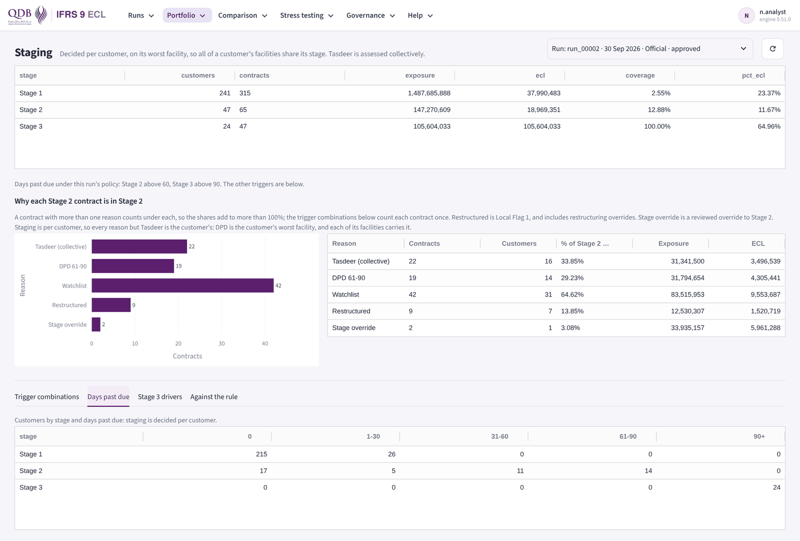

- **Stage 3 drivers** — default flag, DPD > 90, insolvency, contagion.
- **Against the rule** — contracts whose stage differs from what the DPD and
  flags alone would give, with the reason (override, contagion, collective).
  This list should be short and every row explainable.

## 11.4 Risk parameters

*Tabs: Probability of default · LGD & collateral · Exposure*

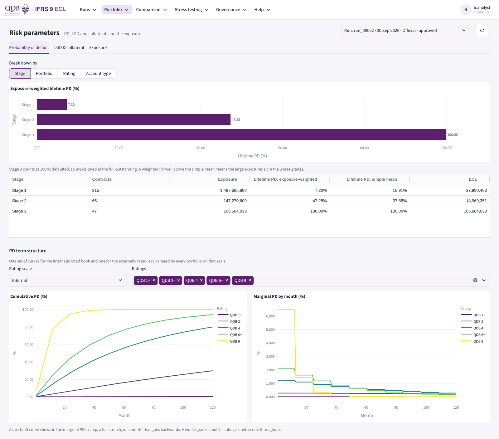

**Probability of default** — **Break down by** Stage, Portfolio, Rating or
Account type.

- **Exposure-weighted lifetime PD** bar and table: exposure-weighted and
  simple-mean PD per group. A weighted PD well above the simple mean means the
  large exposures sit in the worse grades. Stage 3 shows 100%.
- **PD term structure** — choose the **Rating scale** (Internal / External)
  and the **Ratings** to draw. *Cumulative PD (%)* by month should rise and
  flatten; *Marginal PD by month (%)* shows each month's default
  probability. A worse grade should sit above a better one throughout; a
  step, a flat stretch or a month that goes backwards marks a mis-built
  curve. The steps at months 12, 24 … 60 are the yearly PiT PDs; after year 5
  the curve reverts towards TTC.

**LGD & collateral** — tiles for the **Weighted LGD**, the exposure **On the
floor** and its share **Of contracts**; LGD against collateral coverage; and
the collateral data: **Collateral records**, **Allocations**, **Orphan
allocations** (allocations to a contract or collateral item that does not
exist) and the **Contracts affected**. The floor is 0.45 × 0.5 = 0.225: past
about 50% coverage more collateral changes nothing, so the flat line on the
chart is the floor, not an error. Coverage is capped at 200% on the axis.

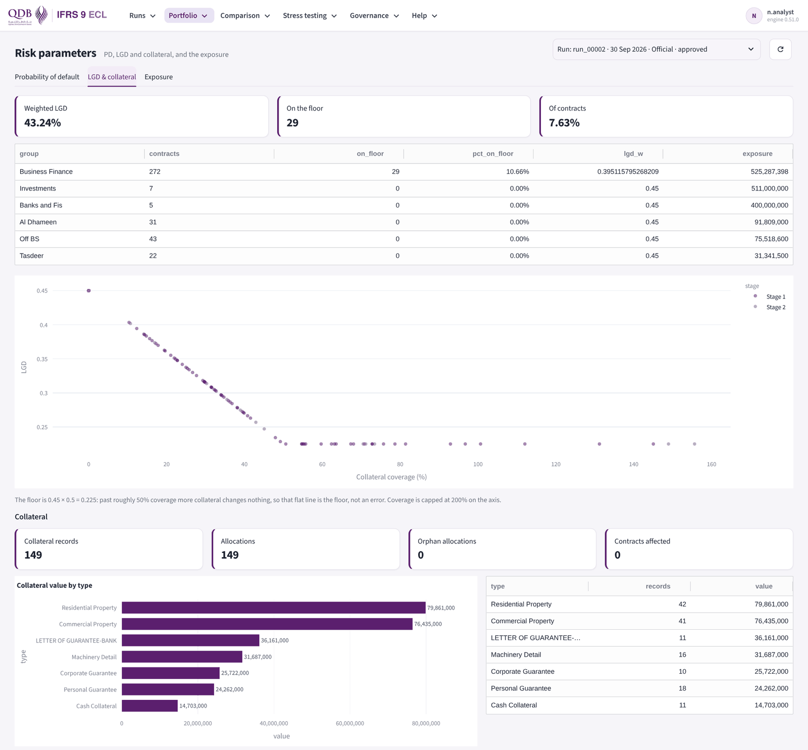

**Exposure** — **Exposure by remaining maturity** in bands (*Past
due/matured*, 0–3m, 3–6m, 6–12m, 1–2y, 2–3y, 3–5y, 5–10y, 10y+). The
remaining term sets the Stage 2 lifetime horizon, so a book that shortens
lowers the Stage 2 ECL even with no change in credit quality.

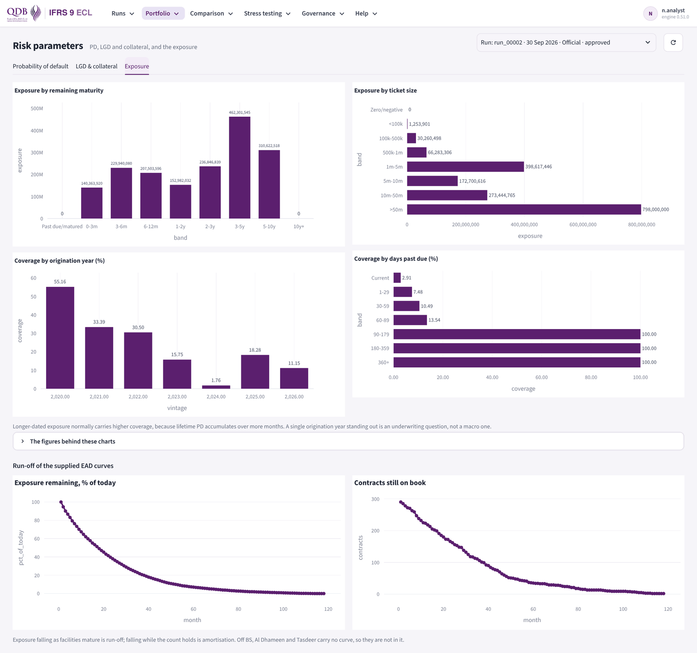

## 11.5 Concentration

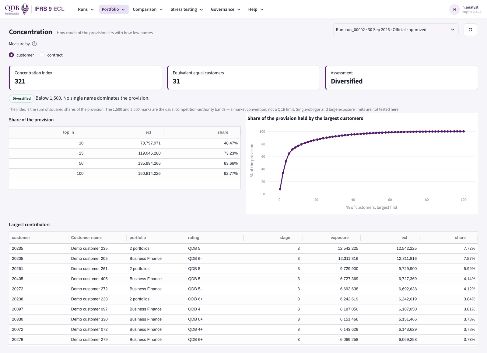

How much of the provision sits with how few names. **Measure by** customer
or contract.

- **Concentration index** — the Herfindahl index of the provision shares
  (Σ share² × 10,000). **Equivalent equal customers** is 10,000 ÷ index: the
  number of equal-sized names that would give the same concentration.
  **Assessment**: *Diversified* below 1,500, *Moderately concentrated*
  1,500–2,500, *Highly concentrated* above. These are the usual
  competition-authority bands, a market convention, not a QCB limit;
  single-obligor and large-exposure limits are not tested here.
- **Share of the provision held by the largest customers** — the curve of
  cumulative provision against the share of customers, largest first. The
  more it bows towards the top left, the more concentrated the provision.
- **Largest contributors** — the names with the largest provision, their
  share and cumulative share.

Use it for the top-name disclosure and to pick the names for a *Largest N
default* stress (Section 13.4).

## 11.6 Segments

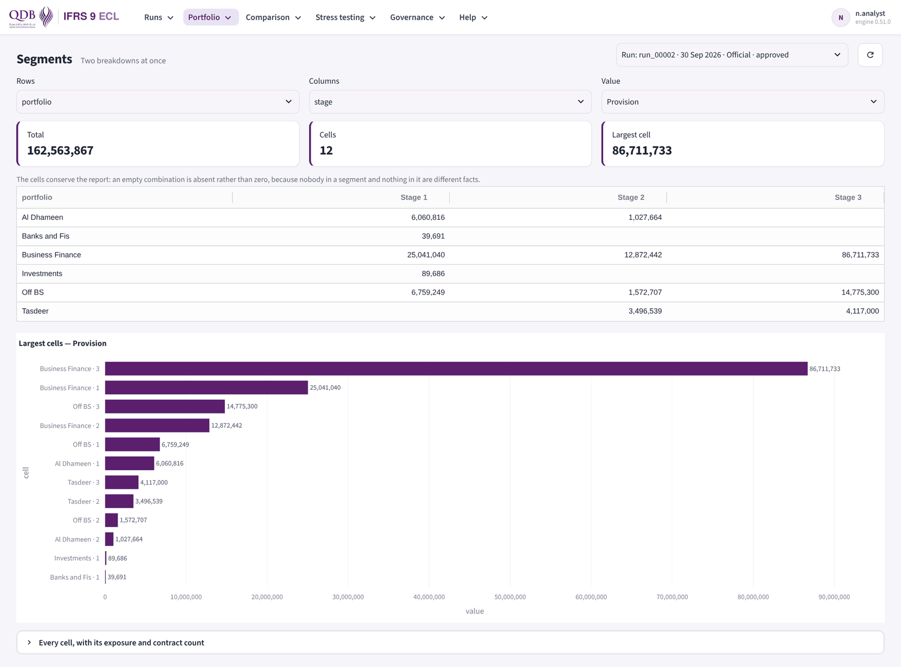

Two breakdowns at once. Choose **Rows** and **Columns** (portfolio, stage,
rating, account type) and the **Value** (Provision, Exposure, Coverage %,
Contracts). Tiles
give the **Total**, the number of **Cells** and the **Largest cell**;
**Largest cells** ranks them, and the expander *Every cell, with its exposure
and contract count* lists them all. The cells add back to the report. An
empty combination is absent rather than zero: nobody in a segment and nothing
in it are different facts.

## 11.7 Scenarios

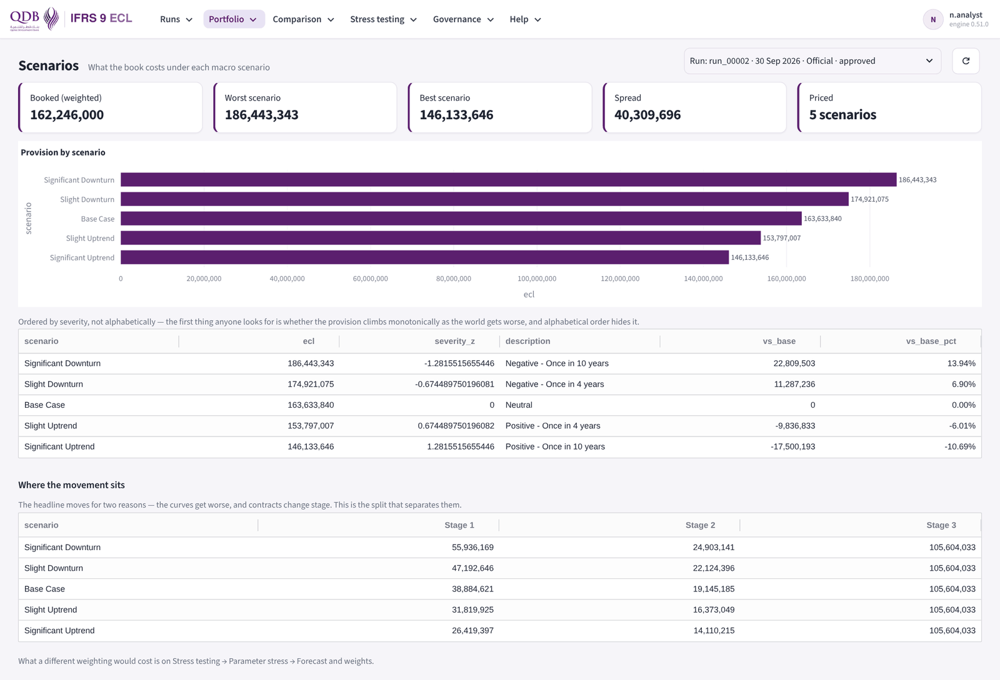

- **Tiles** — *Booked (weighted)*: the provision on the probability-weighted
  PD curve, which is what is booked; *Worst scenario*, *Best scenario*,
  *Spread* (worst − best) and how many scenarios were *Priced*.
- **Provision by scenario** — ordered by severity, not alphabetically, so it
  is easy to see that the provision climbs as the scenario gets worse. It
  must climb monotonically; if it does not, the scenario PDs are wrong.
- **Table** — each scenario's ECL, severity z, description, and the
  difference from the base case in QAR and percent.
- **Where the movement sits** — each scenario's ECL by stage. Stage 3 does
  not move (it is at 100%); the spread sits in Stages 1 and 2.

The booked figure is not the average of the five scenario figures: the
weights are applied to the marginal PDs before pricing (methodology §7.5).

## 11.8 Data quality

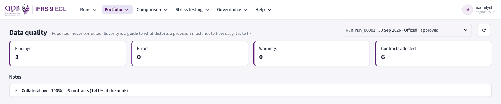

Data problems in the run's inputs — *reported, never corrected*. Tiles count
the **Findings**, **Errors**, **Warnings** and **Contracts affected**; each
finding opens to its contracts, e.g. *Collateral over 100% — 6 contracts
(1.41% of the book)*. Severity is a guide to what distorts a provision most,
not to how easy it is to fix. Send the list to the data owner; the fix belongs
in the source system, not in the tool.

## 11.9 ECL calculator

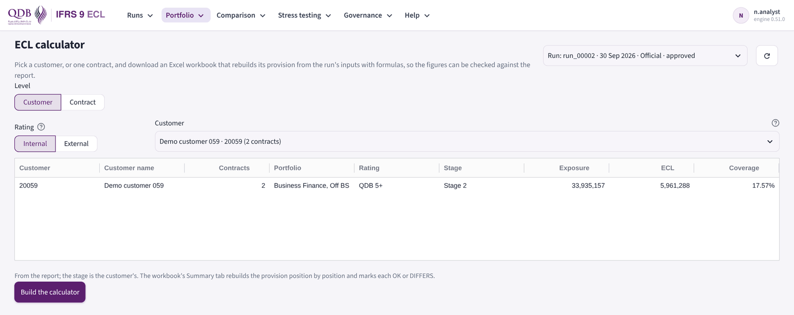

Pick **Level** (Customer or Contract), the **Rating** scale, and the customer
or contract; press **Build the calculator**. The tool writes an Excel
workbook that rebuilds that provision from the run's inputs **with live
formulas**: the PD curve from the TTC PD and scenario factors, the EAD
schedule, the LGD from collateral and haircuts, the discounting and the sum.
Its *Summary* tab compares each figure with the run's report and marks it
**OK** or **DIFFERS**. Use it for audit queries ("show me how contract X's
ECL was computed") and to train new users.

# 12. Comparing runs

The Comparison pages read two runs: **Run** (current) and **Against**
(previous). Choose the quarter-end run and last quarter's.

## 12.1 Movement

*Comparison → Movement* — why the provision moved, cause by cause.

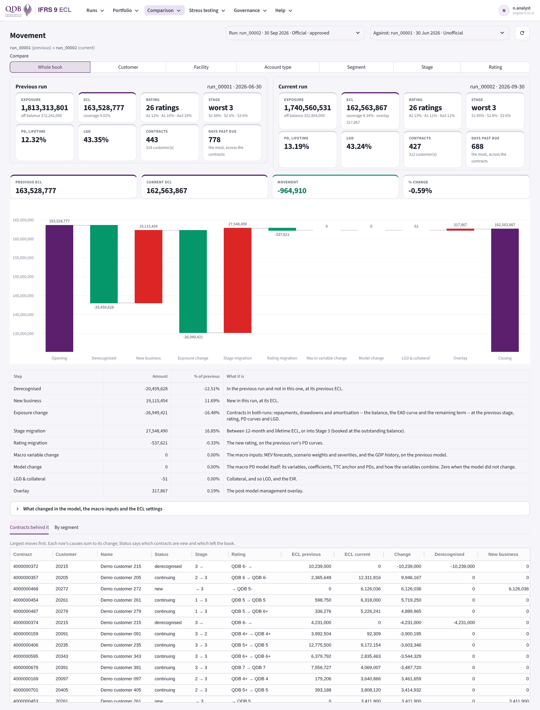

**Compare** sets the level: *Whole book*, *Customer*, *Facility*, *Account
type*, *Segment*, *Stage*, *Rating*. Below it:

- **Previous run / Current run** cards — exposure (and off-balance), ECL and
  coverage (with the overlay), number of ratings and the largest shares,
  worst stage and stage split, lifetime PD, LGD, contracts and customers, the
  largest days past due.
- **Tiles** — Previous ECL, Current ECL, Movement, % change.
- **The bridge (waterfall)** — from the opening provision (left, plum) to
  the closing provision (right, plum). Each bar in between is one cause: red
  raises the provision, green lowers it. The causes are applied **in a fixed
  order**, each on top of the ones before, so they add exactly to the
  movement:

| Step | What it is |
|---|---|
| Derecognised | in the previous run and not in this one, at its previous ECL |
| New business | new in this run, at its ECL |
| Exposure change | contracts in both runs: repayments, drawdowns and amortisation — the balance, the EAD curve and the remaining term — at the previous stage, rating, PD curves and LGD |
| Stage migration | between 12-month and lifetime ECL, or into Stage 3 (booked at the outstanding balance) |
| Rating migration | the new rating, on the previous run's PD curves |
| Macro variable change | the macro inputs: MEV forecasts, scenario weights and severities, and the GDP history, on the previous model |
| Model change | the PD model itself: variables, coefficients, TTC anchor, how the variables combine; zero when the model did not change |
| LGD & collateral | collateral, and so LGD, and the EIR |
| Overlay | the post-model management overlay |

The table under the chart gives each step's amount, its % of the previous
provision, and the definition. **What changed in the model, the macro inputs
and the ECL settings** lists the configuration differences behind the macro,
model and settings steps.

**Reading it**: in the demonstration, the provision fell 0.96 m (−0.59%):
derecognised −20.5 m and amortisation −26.9 m were mostly offset by new
business +19.1 m and stage migration +27.5 m. The headline barely moved, but
the book underneath turned over — the bridge is what shows that.

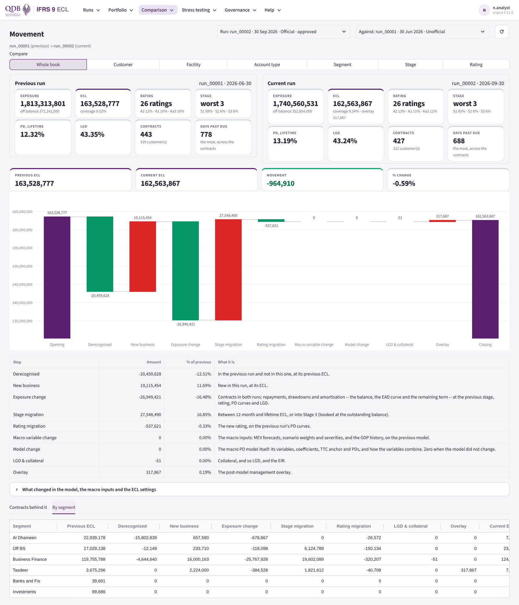

**Contracts behind it** — one row per contract, largest move first: status
(*continuing*, *new*, *derecognised*), stage and rating before → after, ECL
previous and current, the change and its split across the causes (the
columns add to the change). **By segment** — the causes per portfolio.

## 12.2 Migration

*Comparison → Migration* — customers, not contracts: stage and rating are set
per customer.

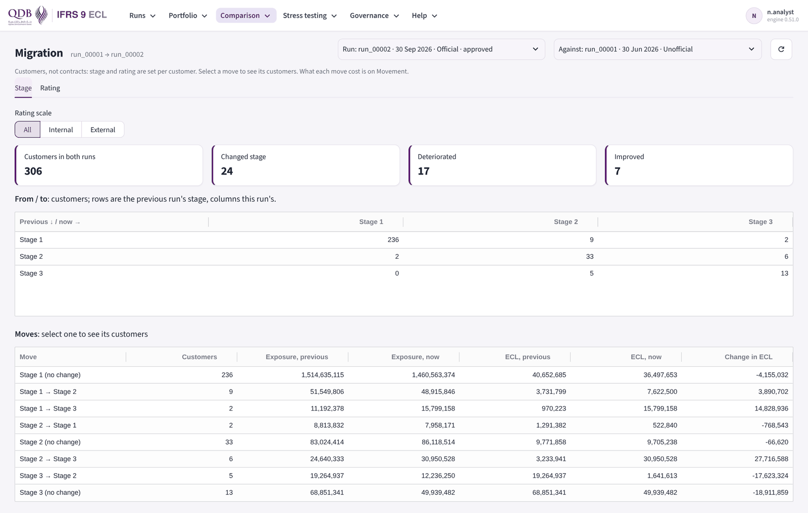

**Stage** tab

- **Rating scale** — All, Internal, External.
- Tiles — **Customers in both runs**, **Changed stage**, **Deteriorated**,
  **Improved**.
- **From / to** matrix — rows are the previous run's stage, columns this
  run's. The diagonal is the customers that did not move; above it
  deteriorated, below it improved. Read the Stage 1 → 3 cell carefully: a
  customer jumping straight to default without passing Stage 2 says the
  staging triggers are late.
- **Moves** table — each move (e.g. *Stage 1 → Stage 2*) with customers,
  exposure and ECL before and after and the change in ECL. Select a move to
  list its customers.

**Rating** tab — the same for grades, one scale at a time: the grade
transition matrix (previous grade in rows, current in columns), the share
upgraded and downgraded, and the moves. What each move cost is on Movement.

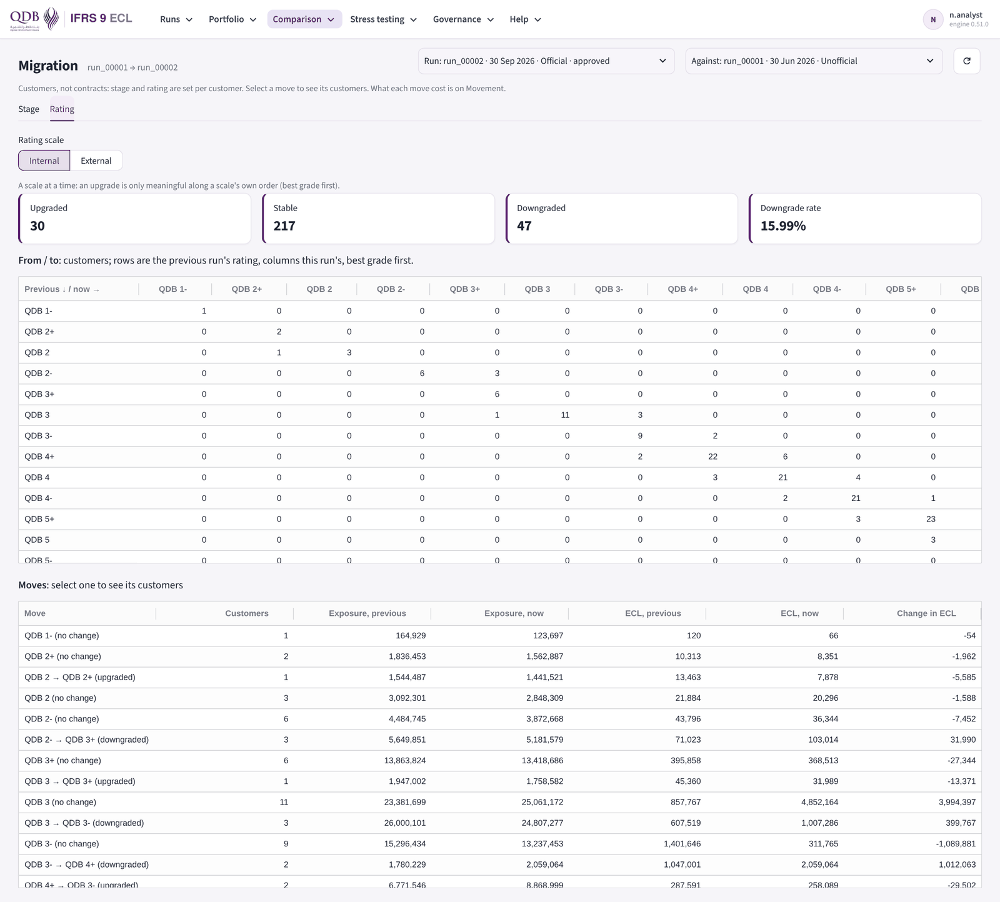

## 12.3 Reconcile & export

*Comparison → Reconcile & export*

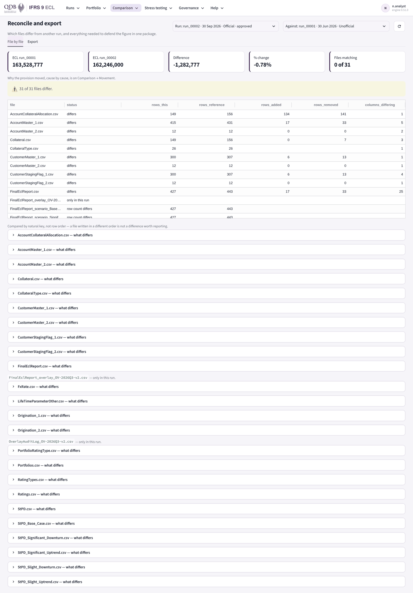

**File by file** compares every output file of the two runs **by natural
key, not row order** (a file written in a different order is not a
difference). The banner says how many differ (e.g. *31 of 31 files differ*);
each file opens to the rows added, removed and changed, and a file only in
one run is named (e.g. the overlay report). Use it after a rerun of the same
quarter: only the files you expected to change should differ.

**Export** packages the run (Section 10.3): tick **Include the raw source
extracts** if needed and press **Package this run**.

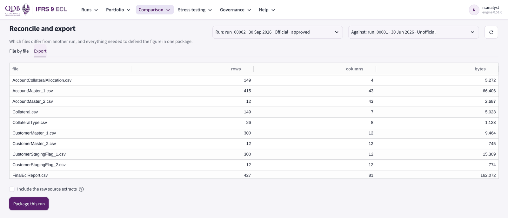

# 13. Stress testing

Four pages. None of them changes a run: each reprices a copy of the run's
book in memory and shows the difference.

| Page | Answers |
|---|---|
| **Parameter stress** | "what if PDs double / ratings drop 3 notches / collateral falls 30%?" — change risk parameters directly |
| **Macro data** | the macro store behind the scenarios (Section 6) |
| **Scenario library** | the scenarios: historical episodes, supervisory scenarios and your own |
| **Scenario stress** | "what would the 2015 oil collapse cost on today's book?" — price a macro scenario through the PD model, stage moves and collateral |

The method behind each is in the Stress testing methodology.

## 13.1 Scenario library

*Stress testing → Scenario library* — nothing is priced here.

The left column lists the scenarios: **Global events**, **GCC and Qatar**,
**Supervisory** and your **Saved** ones. Select one; three tabs:

- **Scenario** — the historical event (or the supervisor's scenario), the
  **Recorded data** around the episode (shaded: the years replayed; dotted:
  the IMF projection for years not yet recorded), the **Scenario narrative**
  year by year, **Variables set** with their values and the basis for each
  (e.g. *Oil price −32.0, +65.8%: the oil price's recorded change in
  2020–21*), how it reaches the **Provision calculation**, limitations and
  **Sources**.
- **Variables affected** — every variable year by year, marked *set* (by the
  scenario) or *linked* (moved by the linked effects).
- **Transmission** — **How the shock travels**: a graph from each driver to
  the variables it moves, with the share of the move that comes from it
  (channels under 15% left out). Plum = set by the scenario, teal = moved by
  the linked effects. **Each linked variable** explains every bar: the
  drivers' parts plus momentum add to the dot.

The note at the bottom left gives the macro vintage the linked effects were
estimated on.

## 13.2 Build a scenario

Press **New scenario** (or **Edit as new** on a library scenario — a library
scenario is never changed; editing opens a copy saved under a new name).

| Field | Accepts |
|---|---|
| **Name** | required, e.g. *2027 oil price shock −40%* |
| **Type** | *Own* (listed under Saved) or *Supervisory* (a published scenario, listed under Supervisory) |
| **Region** | *Global*, *GCC*, *Qatar* — where the shock starts |
| **One-line description**, **Source** | free text |
| **Historical event or basis**, **Scenario narrative** | free text: what the scenario stands for and how it unfolds from Y1 |
| **Main variables** table | one row per variable you set (next table) |
| **Variables that move with the main ones** | the linked variables; untick one to leave it at the run's forecast (it then passes nothing on) |
| **Deferral programme: Stage 1 moved to Stage 2 (%)** | 0–100; the share of performing Stage 1 borrowers a payment-deferral programme moves to Stage 2 on top of the rating effect (about 72% in 2020) |
| **Provision calculation**, **Limitations** | optional notes |

Main variables table:

| Column | Accepts |
|---|---|
| **Variable** | one of the model's macro variables (oil price, world GDP growth, US policy rate, government spending, non-oil GDP growth, private credit growth, property prices, GCC growth …) |
| **Shape** | *One year* (the shock in Y1 only), *Recovers* (the shock in Y1, fading to zero over *Over years*), *Held* (the same shock every year), *Year by year* (type each year) |
| **Size** | the shock in the variable's unit: points for growth rates and the policy rate (`-5` = 5 points lower), percent for prices (`-30` = 30% lower) |
| **Over years** | for *Recovers*: years to recover (default 2) |
| **Y1 … Y5** | filled from the shape; type a year to override (the row becomes *Year by year*); a blank year is filled by the linked effects |
| **Rationale** | required for every main variable: the episode, study or publication behind the size |

The shock is **relative to the run's own forecast**: a −5 on non-oil growth
means 5 points below whatever the run's forecast is for that year. **Save**
keeps a new version of a saved scenario (every version is kept); **Save as
new** makes a copy; **Delete** removes your own scenario.

**Import a Fed scenario** — **Download from the Fed** (the February
publication's four tables: baseline and severely adverse, domestic and
international) or **Or upload the four tables (CSV)**; the tool turns the
severely adverse less the baseline into world GDP growth and the US rate;
everything else follows through the linked effects. **Save to the library**.

## 13.3 Scenario stress

*Stress testing → Scenario stress*. The line under the title gives the run's
first scenario year, the macro vintage and the provision (e.g. *Y1 is 2026
on this run · macro data v20261122-084748 · provision 162,246,000*).

**Price** — pick a **Scenario**.

- Tiles: **Provision now**, **Under the scenario**, **Change**, **% change**.
- A bridge from the provision now to the provision under the scenario
  through its three channels — **PD model**, **Stage moves**,
  **Collateral** — each explained in a sentence, e.g. *PD model — the average
  12-month PD of the performing book goes from 8.81% to 8.93%*; *Stage moves —
  about 0 of 303 Stage 1 contracts move to Stage 2*; *Collateral — property
  prices at their lowest −1.9% below today's, on 83 contracts with property
  collateral*.
- **What drives it** — the change split by main variable.
- **By sector** and **By portfolio** — where the change lands.
- Expanders: **The scenario on this run, 2026–2030** (each variable's path
  against the run's forecast) and **Customers most affected**.

**Compare** — tick several **Scenarios** and press **Compare**: one bar each,
the provision under each, ordered by severity, and the table of the
channels.

**Sensitivity** — how much a standard move in each variable costs.

| Field | Accepts |
|---|---|
| **Adverse move (standard deviations)** | 0.25 – 4.0, step 0.25 (default 1). A standard deviation is each variable's own, from its yearly history (Macro data → Variables). |
| **Shape** | one_year, recover, held |
| **With the linked effects** | on: the other variables follow; off: the variable alone |

Press **Run**: a bar per variable, the cost of an adverse move of that size.
**One variable over a range** → **Draw** prices one variable across a range
of shocks. **How sure: the PD model's slope on its main variable** → **Price
the range** prices the chosen scenario at the low and high end of the slope's
confidence interval.

**ECL at risk** — the provision's distribution over simulated macro paths.

| Field | Accepts |
|---|---|
| **Paths** | 200 – 20,000 (default 2,000) five-year macro paths, drawn from the linked-effects model |
| **Seed** | any whole number; the same seed gives the same paths |
| **Provision threshold (QAR m, optional)** | 0 = none; otherwise the chance of exceeding it is reported |

Press **Simulate**. Tiles: **Provision now**, **Mean over paths**, **ECL at
95%** and **ECL at 99%** (each with its change from now) and, with a
threshold, **Chance above threshold**. The histogram of the provision over
the paths marks *now* and the percentiles. **Where the scenarios fall** places
each library scenario on the distribution (*worse than 97% of paths*), so a
committee can see how rare its "severe" scenario is. **What drives the
tail** and **Tail by sector** split the 99% change by channel and sector; the
expander **Credit loss over the next year** gives the expected loss and the
loss percentiles if customers default at their stressed PD, with the
customers that carry the tail.

**Reverse stress** — what it takes to reach a given loss.

Type **Increase in provision to reach (QAR m)** and press **Find**. Tiles:
**Target**, **Paths reaching it** (the share of simulated paths that do) and
**About one in** (its rarity). **Each scenario, scaled** — how many times its
moves each library scenario needs to reach the target. **Each variable
alone** — the year-1 shock in one variable that reaches it, with how many
standard deviations that is.

## 13.4 Parameter stress

*Stress testing → Parameter stress* — four views: **Stress test**, **Lever
sensitivity**, **Forecast and weights**, **Roll forward**.

### Stress test

Choose who is stressed and what moves, then reprice. Each stress is a card
("package"); several can be priced together.

- **Add a package** — a blank card. **Add the standard packages** — adds
  the five standard stresses (below). **Save** writes the packages on screen
  to `config/stress_packages.yml` so the same stresses run every quarter;
  **Load saved** brings them back.

**Who** is stressed:

| Field | Accepts |
|---|---|
| **Name** | a label, e.g. *Severe downturn* |
| **Portfolios** | any of the run's portfolios; empty = every portfolio |
| **Stages** | 1, 2, 3; empty = every stage |
| **Customer ids** | comma separated; empty = every customer |

**What moves** (all optional; leave a lever at its default for no change):

| Lever | Accepts | Effect |
|---|---|---|
| **Stage 2 DPD threshold** | 0 – 365 days (the run's is shown in ⓘ, normally 60) | restages at a stricter or looser trigger |
| **Move to stage** | unchanged, 1, 2, 3 | forces the contracts in scope into that stage — **including Stage 3 ones, which a move to 1 or 2 cures**; set **Stages** to 1 (or 1 and 2) to move only performing contracts |
| **Largest N default** | 0 – 100 | the N largest customers by exposure go to Stage 3 |
| **PD multiplier** | 0 – 10 (1 = no change) | multiplies the PD curves (capped at 100%) |
| **PD scenario** | weighted, or one scenario | prices on one scenario's PD curves instead of the weighted curve |
| **Rating notches** | −10 to +20; positive is a downgrade | moves each customer down the scale, capped at the worst performing grade |
| **Maximum LGD (unsecured)** | 0 – 1 (the run's is 0.45) | the LGD of an unsecured exposure |
| **Minimum LGD (fully secured)** | 0 – 1 (the run's is 0.225 = 0.45 × 0.5) | the LGD floor |
| **Collateral %** | 0 – 300 (100 = no change; 70 = collateral down 30%) | scales collateral values |
| **Exposure %** | 0 – 300 (100 = no change; 110 = +10%) | scales exposures (e.g. drawdown of undrawn lines) |
| **Extend maturity (years)** | −10 to 30 | lengthens the remaining term (Stage 2 horizon) |

Press **Run** on a card, or **Run all N** to price every package.

Tiles: **Provision now**, **Worst package**, **Under it**, **Change** and
**As a share** of the provision now. **Change in provision by package** ranks
them; the table gives each package's provision before and after, the change,
the %, the **contracts in scope** and how many were **re-staged**. Each
package is priced on its own from the same run, so **the changes do not add
up**. Open a package's line (e.g. *Severe downturn — +121,236,290*) for its
split by portfolio and stage.

**The standard packages**

| Package | Levers |
|---|---|
| Mild downturn | PD × 1.25, 1 notch down, collateral 90% |
| Severe downturn | PD × 2, 3 notches down, collateral 70%, exposure 110% |
| Collateral revaluation | collateral 50% |
| Staging tightened to 30 days | Stage 2 DPD threshold 30 |
| Largest five default | the 5 largest customers to Stage 3 |

A package that changes nothing is not a fault: e.g. *Staging tightened to 30
days* moves nobody when no Stage 1 customer is 31–60 days past due (check
*Staging → Days past due*).

### Lever sensitivity

Three tabs:

- **Each lever** — every lever moved by a standard step on its own. Tiles:
  **Provision at base**, **Most sensitive to**, **That lever's effect**; a
  tornado chart (largest effect at the top) and the table (lever, provision,
  change, %).
- **To a target** — type **Target provision increase (%)** (1 – 500) and
  press **Solve**: how far each lever has to move, on its own, to raise the
  provision by that much. A lever that cannot reach it shows the most it
  achieves; if none can, a combination is needed (build it on Stress test).
- **Staging threshold** — tick **Thresholds to price (days)** among 0, 15,
  30, 45, 60, 75, 90 and press **Reprice**: the book re-staged at each Stage 2
  DPD threshold, everything else unchanged. The policy in force is always
  included.

### Forecast and weights

- **Macro forecast** — a slider per internal-model variable, *change in every
  year (points)*, −5 to +5 in 0.25 steps, with the forecast path redrawn;
  for the externally rated book, *GCC GDP growth: change in every year
  (points)*. **Scenario weights**: *Keep this run's* or *Recalculate from the
  new forecast*. **Reprice**. A variable with a zero model weight (real-estate
  and credit growth in the current model) changes nothing — that is the
  calibration, not a fault.
- **Scenario weights** — this run's weights for the internal and external
  scale, editable as percentages (0 – 100; they must add to 100); **Reprice**
  gives the provision under the weights typed. Use it to show the committee
  what a different weighting would cost.

### Roll forward

The provision in *n* months if nothing changes but time: same contracts,
same ratings, same stages. Choose **Months** (3 – 60, step 3) and press
**Roll forward**. Each contract repays along its schedule, the months that
have passed without a default are no longer at risk, and contracts that
mature drop out. Tiles: **Provision today**, **In n months**, **Change**,
**% change**, **Contracts matured**, and the exposure today and then. Use it
as the "run-off" baseline against which to judge next quarter's new
business and migration.

# 14. Governance pages

## 14.1 Calculator versions

*Governance → Calculator versions*

The calculator version is the engine version. A run records it with a
fingerprint of the code that ran. Tiles: **Calculator version**, **Code
fingerprint**, **Against the archive** (*Unchanged* or *Changed*) and the
**Working tree** state. A *Changed* warning (*the deployed code is not the
code archived for 0.51.0 … the code changed without a new version number*)
means the code was edited without a version bump: an official run should not
be made until it is released under a new version. **Versions** lists each
version with its archive; an earlier one can be picked on Run the pipeline to
rerun from its archived code.

## 14.2 Live configuration

*Governance → Live configuration* (page title *Model configuration*)

What the engine is calibrated to: the TTC anchor PD, forecast years, maximum
maturity (50 years), the LGD base and floor, the macro variables with their
weights and coefficients, the macro forecast and the scenario weights.
These change when the model changes, not each quarter. A warning names any
variable with zero weight (shocking it changes nothing). **Edit** saves
`config/` files on disk only if they still parse; a run freezes its own copy,
so past runs are unaffected. For quarterly changes use a config version
(Section 5) — editing the live config bypasses the approval trail.

## 14.3 Model assumptions

*Governance → Model assumptions* — the assumptions **as frozen by the
selected run**.

Scenarios and their severities (z: −1.28 is a once-in-ten-years downturn, 0
neutral); the scenario weights the run priced with, internal and external
(the external scale has a weight vector a year; its average is shown), and
the explicit weights written in the file (used only when the mode is
*explicit*); the macro variables with weight and coefficient (*weight and
coefficient together are the model*); and the forecast the run priced on,
year by year. Use it to answer "what assumptions produced this quarter's
number?" without opening a file.

## 14.4 Audit log

*Governance → Audit log*

| Tab | Shows |
|---|---|
| **Project log** | every event (runs, approvals, config and overlay transitions, edits, exports), filterable by **Event type**, **Run ID**, **User** |
| **Frozen configuration** | the selected run's frozen configuration: when taken, by whom, and the hash of every file (*hashes, not just copies: a copy can be edited afterwards and still look original*) |
| **This run's activity** | the run's own append-only `audit.jsonl` |
| **Compare runs** | file-by-file hashes of the two runs' configuration; *The configuration is identical between the two runs, so any change in the numbers came from the data*, or the files that differ |

# 15. Help

## 15.1 Assistant

*Help → Assistant*

Ask questions in plain language about the runs, the model, the configuration
and how the tool works. Figures come from the same lookups as the pages;
explanations come from the documents under Help (the ECL methodology, the
stress testing methodology and this manual). It is read-only: it cannot run,
edit or approve anything, and says which page does.

**What it can do**

| Ask about | Examples |
|---|---|
| A run's figures | *What is the ECL by stage?* · *Show the stage split by portfolio* · *Coverage by rating for Stage 2* · *Exposure by remaining maturity* |
| Comparing runs | *Which portfolio moved most between the two runs?* · *Why did the ECL change since the previous run?* · *What is the difference between run 22 and run 23?* · *Rating migration* |
| Who moved stage, and why | *Which customers moved from Stage 2 to Stage 3 in the two runs?* · *Who was downgraded to Stage 3?* · *Which customers cured?* — each customer with the reason for its new stage and what changed (DPD, watchlist, restructuring, default flag, override, rating) |
| Why a customer is in its stage | *Why is 20235 in Stage 2?* · *Why is <name> in Stage 3?* — the staging rule's inputs for that customer and the reason |
| Customers and contracts | *Top 10 customers by ECL* · *Show customer 20235* · *Largest contracts by exposure in Off BS* |
| Staging, scenarios, PD | *Why are contracts in Stage 2?* · *ECL under each scenario* · *Plot the PD curves for QDB 3, QDB 5 and QDB 7* |
| Model and configuration | *What are the MEV coefficients?* · *What haircut does commercial property get?* · *What scenario weights did this run use?* |
| Governance | *Which validation checks failed?* · *Who approved this run?* · *Which overlays are approved?* · *List the config versions* |
| How the method works | *How is the PiT PD calculated?* · *How is LGD calculated?* · *How is Stage 2 decided?* · *What is the exposure cap?* — the steps with their formulas, and every version the documents describe (internal and external scale, lending and investments) unless you name one |
| How the tool works | *How do I approve an overlay?* · *How do I run the ECL?* |
| One portfolio | *What's going on in Al Dhameen?* · *How is Tasdeer treated?* — how the portfolio is treated (ECL methodology, chapter 16) and its figures against the previous run |
| Regulation | *Compare our collateral haircuts with Basel and QCB* · *Is our 60-day backstop in line with IFRS 9?* · *What does the EBA stress test do with stage transfers?* · *Which regulatory documents do you have?* — QDB's setting (from the run's own config) beside each rule with its paragraph, and the passages it rests on |
| The code (only when asked) | *Where is the function that computes LGD?* |

**What an answer contains**

- **The answer** in a few sentences, with the key figures.
- **A chart, a table or both**, chosen for the result: a chart with its table
  for splits, comparisons and the movement (a waterfall); the chart with the
  table folded under it for PD curves; a table alone for lists of customers,
  one customer and validation results. Say *as a table* or *as a chart* to
  choose yourself. Both are drawn from the lookup's own numbers; every table
  has **Download as Excel** (one sheet per table, numbers as numbers).
- **From the documents** — for a methodology or how-to question, the answer
  is a short guide in plain words, followed by the sections it rests on,
  whole (text, formulas, worked examples). Formulas are always the
  document's own, never retyped by the model.
- **Links** — every source opens in a new browser tab: a citation such as
  *§7.4* or *Open in the document* opens the Help document at that section,
  highlighted at the top; a regulatory reference (CRE22.49, B5.5.37, the EBA
  Methodological Note, KPMG ...) opens the official document, or your own
  copy in `docs/regulatory` at the cited page; tables of comparisons have a
  *source* column with the same links. The **Sources** line under the answer
  lists them all. Engine code is cited only when you ask about the code.
- **Ask next** — two or three follow-up questions; click one to ask it.
- **How this was looked up** — every lookup with its arguments, so any figure
  can be traced.

**Regulatory texts.** The assistant knows the Regulatory reference document
(Help → Regulatory reference: IFRS 9, Basel, QCB, EBA, Bank of England,
Federal Reserve, FINMA). To let it read the official texts themselves — the
QCB circulars above all, which hold values such as QCB's collateral haircuts
— save the PDFs in the app's `docs/regulatory` folder (sub-folders are fine).
They are read on this machine the first time they are needed, cited by file
and page, and never uploaded. Ask *Which regulatory documents do you have?*
to see what it has read.

**Every figure is checked.** Before a reply is shown, each amount,
percentage and customer id in it is compared with what the lookups returned.
The model is not allowed to type tables (the app draws them from the run's
data), and a figure or customer the lookups did not give is removed — the
reply then says so under the text. The usual questions (a list of customers, a split, the movement, failed checks, the macro model, PD curves, how something works) are looked up before the model writes anything, so the table is there even if its sentence is poor. If the chat model gets it wrong, the table
under the reply is still the run's own data.

**When it is not sure** it asks back, with options to click — for example
which of several customers matching a name you mean, or which runs to
compare. Without a run named it uses the run chosen at the top; a comparison
is previous run → that run; "biggest" means by ECL. You can name runs as
*run 1*, *latest*, *previous* or by date (*Sep 2026*, *Q2 2026*).

**Good to know**

- Each answer can build on the previous one (*now show it by stage*). Press
  **New chat** to start over.
- Sector is not in the ECL report; ask by portfolio or account type.
- **Model.** The box beside **New chat** picks the chat model: *Gemma 4
  (31B)*, the default, or *Gemma 3 (12B)*. The models are listed under
  `assistant: models:` in `config.yml`. Gemma 4 needs its key: put the line
  `QDB_GEMMA4_API_KEY=<key>` in a file named `.env` in the app folder (copy
  `.env.example`). The file is never committed and is read on every
  question, so no restart is needed. Until the key is there the box shows
  *(needs key)* and the page uses Gemma 3.

## 15.2 The documents

**User manual**, **ECL methodology**, **Stress testing methodology** and
**Regulatory reference** can each be read on screen (chapter picker, search)
and downloaded as Word. The ECL methodology's chapter 16 goes through the six
portfolios one by one; the Regulatory reference puts QDB's settings beside
IFRS 9, Basel, QCB and the stress-testing supervisors.
**How this works** is a one-page summary of the tool.

# 16. Quick reference: accepted values

| Where | Field | Accepts |
|---|---|---|
| Extracts | dates | dd/mm/yyyy, mm/dd/yyyy, yyyy-mm-dd, dd-Mon-yyyy, dd-Mon-yy, yyyy/mm/dd, Excel dates; one format per column |
| Extracts | amounts | plain numbers, no thousands separator |
| Extracts | EIR | percent a year (4.2) |
| Extracts | ALLOCATIONPERCENTAGE | percent (100) |
| Extracts | flags | 1 = yes; 0 / blank = no |
| Config version | label | `YYYY-Qn-vN`; letters, digits, `- _ .` |
| `model_inputs.yml` | forecasts | percent growth (4.44) |
| `model_inputs.yml` | weights | fractions summing to 1 |
| `ttc_pd_table.csv` | ttc_pd | fraction (0.0122); zero allowed |
| `collateral_types.csv` | haircut_general | fraction 0–1 (0 = full value counts) |
| `staging_thresholds.csv` | days | whole days |
| `fx_rates.csv` | fx_rate | QAR per unit |
| Overlay rule | Value | Uplift: % of ECL (15); Higher-of: % of exposure (5); Absolute add: QAR |
| Overlay | dates | `2026-12-31` |
| Override | reason | required, free text |
| Suppression | expiry | date, or none |
| Macro import | file | CSV / XLSX / XLS, long (date, value) or wide, ≤ 200 MB |
| Macro import | frequency | A, Q, M or from the dates |
| Scenario | Size | points for rates and growth; percent for prices |
| Scenario | deferral | 0–100 % |
| Sensitivity | adverse move | 0.25 – 4 standard deviations |
| ECL at risk | paths | 200 – 20,000 |
| Reverse stress | target | QAR millions, ≥ 1 |
| Parameter stress | PD multiplier | 0 – 10 |
| Parameter stress | notches | −10 to +20 (positive = downgrade) |
| Parameter stress | LGD | 0 – 1 |
| Parameter stress | collateral %, exposure % | 0 – 300 (100 = unchanged) |
| Parameter stress | maturity extension | −10 to 30 years |
| Lever sensitivity | target | 1 – 500 % |
| Roll forward | months | 3 – 60 |

# 17. Troubleshooting

| Symptom | Likely cause | What to do |
|---|---|---|
| *An official run cannot start* | the config version is not approved | approve it on the Approval queue, or run unofficial |
| *Start is locked* with blocking findings | an input error | fix at source and validate again; for a known one-off issue, *Accept for this run…* with a reason |
| A file is "missing" though it is in the folder | its name does not match the expected stem (e.g. `Account_Master.xls`) | rename to the expected name (Section 4.1) |
| Dates read as blank | mixed formats in one column, or text like `31.09.2026` | export the column in one of the accepted formats |
| Exposure with **no ECL** on Pricing readiness | a contract with no PD curve (a grade not in `ttc_pd_table.csv`, or a portfolio whose curve is not built) or no EIR | add the grade or fix the rating at source; supply the EIR |
| A product priced in Business Finance by mistake | the product is not in `product_portfolio_mapping.csv` | add it in a new config version |
| An off-balance product shows zero ECL | ONBALANCE is zero and the exposure was put in OFFBALANCE only | supply the credit-equivalent exposure in ONBALANCE (Section 4.2) |
| Collateral has no effect | the collateral type is not in `collateral_types.csv` (counts for nothing), or the LGD is already at the floor | map the type; check *Risk parameters → LGD & collateral* |
| A property-price or credit-growth stress returns zero | those variables carry zero weight in the PD model | expected; see *Live configuration* |
| The approval is refused for the maker's own item | separation of duties | another person approves |
| An overlay check reports overlapping rules | two rules match the same contract | narrow one rule's target |
| Calculator versions shows *Changed* | code edited without a version bump | release a new version before an official run |
| A page shows old figures after an approval or overlay | the page cached the run | press ⟳ next to the run selector |
| The run package cannot be built | the run is pending or rejected | approve it, or package an unofficial run |
